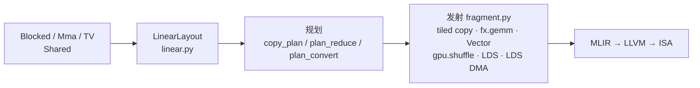
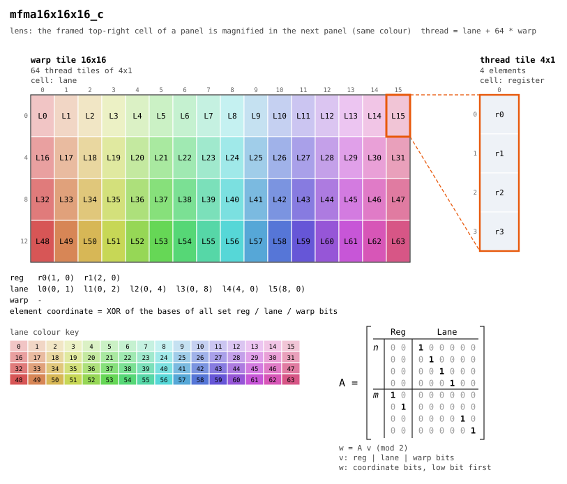
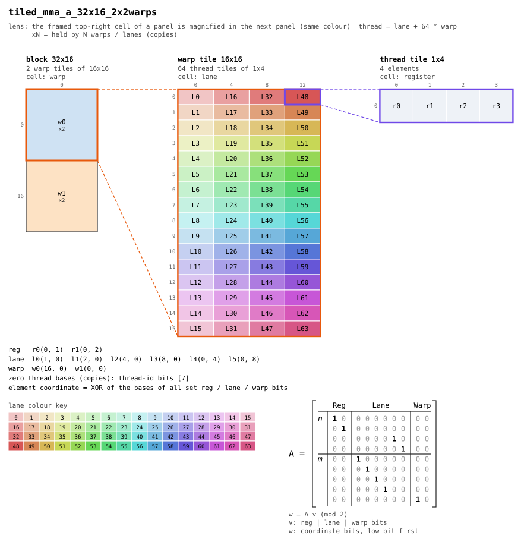
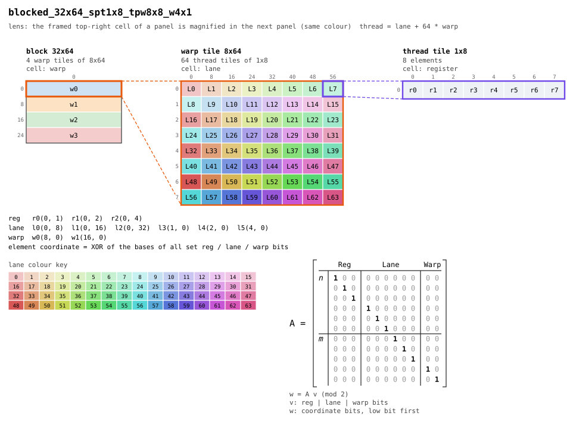
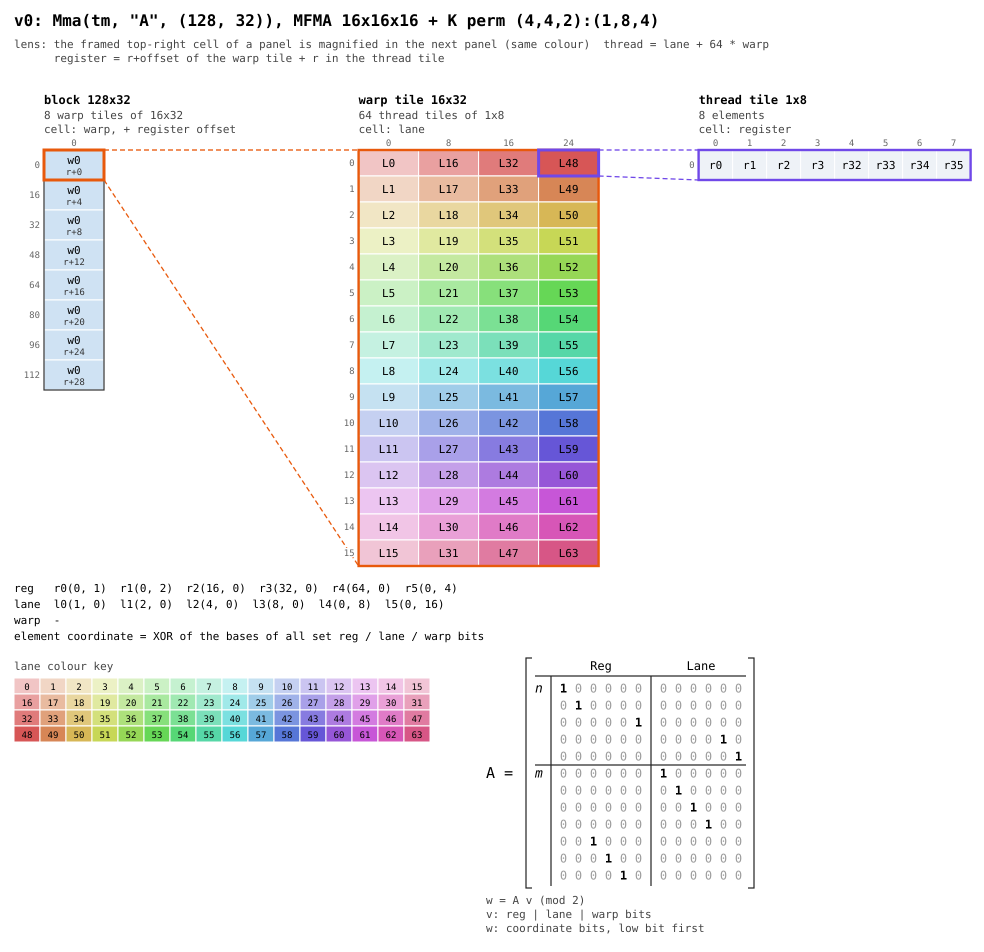
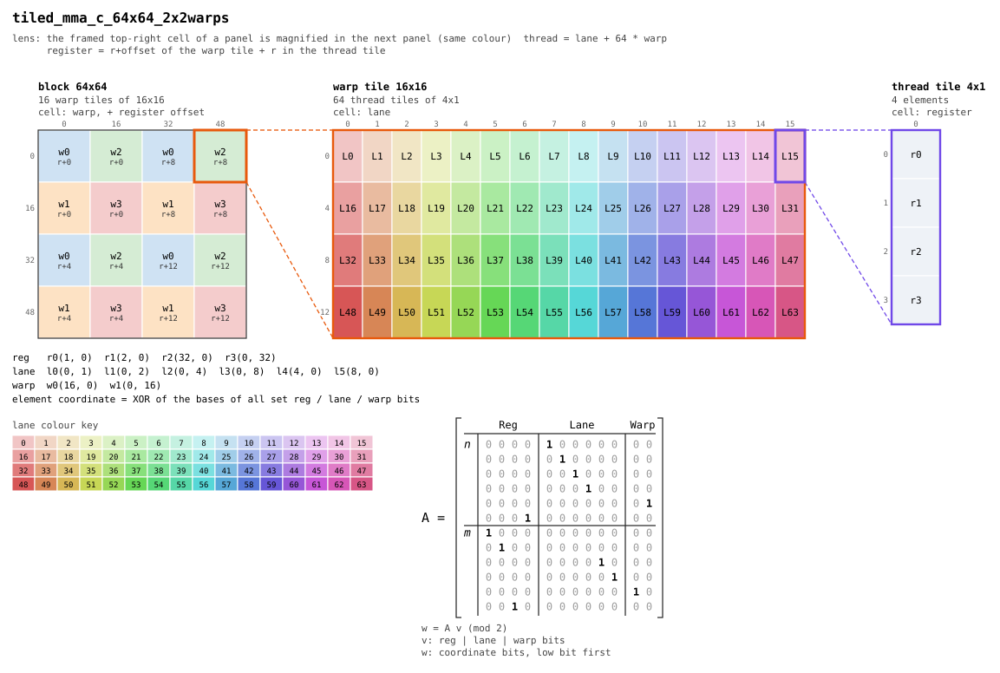
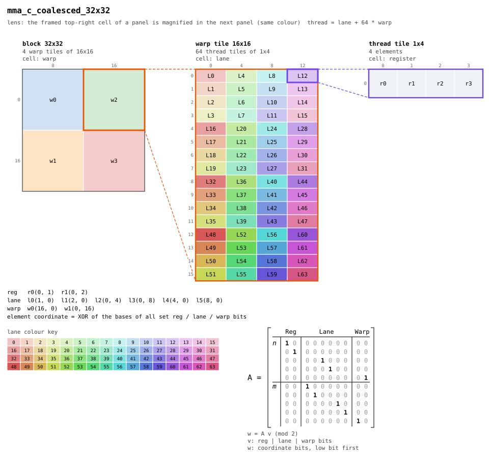
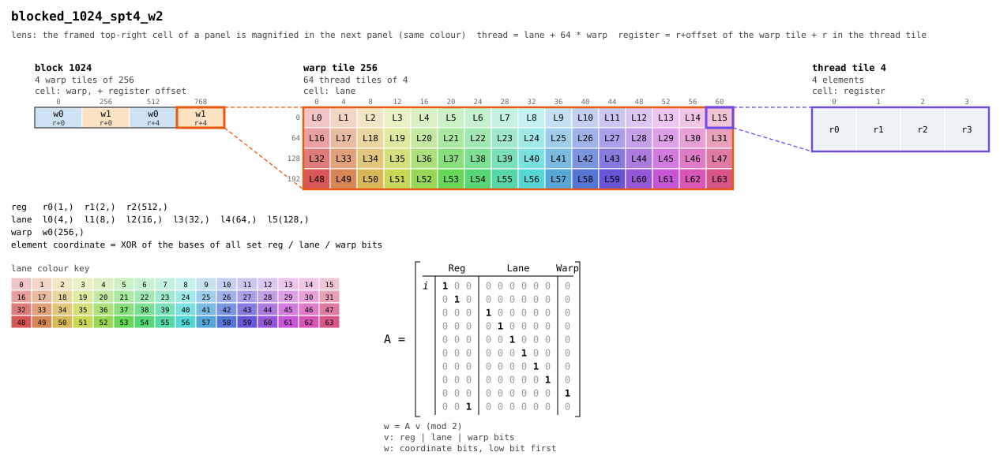
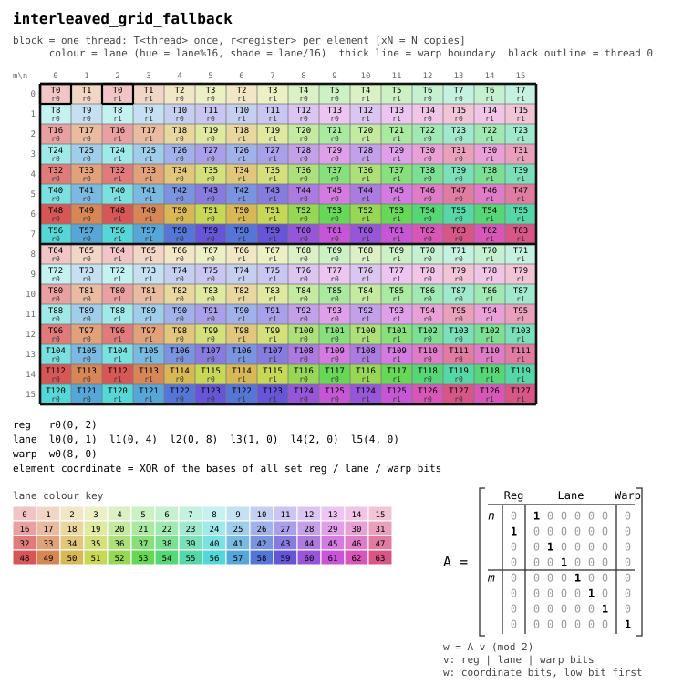

# flydsl_block 设计与实现：用 F2 线性 layout 在 FlyDSL 上写 block 级 kernel

> 基于 commit `d418801`。ISA 片段来自 gfx950 上 FlyDSL 0.3.4.1 的 compile-only 编译（`FLYDSL_DUMP_IR=1`，去掉了注释）；性能数字取自 [examples/README.md](examples/README.md) 的实测。文中的 warp 就是 AMD 的 wave（CDNA 上 64 个 lane）。

## 0. 概览

写 FlyDSL kernel，费劲的往往不是算法，而是数据在线程之间怎么分：一个 256×64 的 tile 由哪个线程的哪个寄存器持有，怎样用 128-bit 指令读进来，怎样换成 MFMA 要的排布，reduce 时哪些值在同一个线程、哪些要跨 lane、哪些要过 LDS。FlyDSL 的 CuTe 式 layout 代数能精确描述这些，但写法是线程视角的：`make_tiled_copy`、`partition_S`、`retile`、`make_fragment_like`……搬一次 tile 就是好几行。

flydsl_block 把视角换成 block：tile 是一个值，`blk.load` / `blk.store` / `blk.dot` 一次处理整块 tile，tile 上可以直接做 elementwise、reduce、broadcast 和 layout 转换。它是纯 Python 库，不改 FlyDSL，也不引入新的 MLIR dialect；block 语义只存在于 trace 期，IR 里只剩 FlyDSL 现有的线程级操作。layout 引擎借用 Triton LinearLayout 的思路：把"哪个线程的哪个寄存器持有 tile 的哪个元素"写成 GF(2) 上的线性映射，向量化、reduce、broadcast、convert 都变成对 bit 的规划。

一些数字：

- 约 2000 行 Python：`linear.py` 508 行（layout 和规划，不依赖 FlyDSL），`fragment.py` 905 行（发出 FlyDSL 操作），`viz.py` 557 行（SVG 可视化）。支持 FlyDSL 0.3.4.1 和 0.5.0。
- 用它改写 gfx942-flydsl-tutorials 的 GEMM（v0～v2，10 个配置）：输出与手写原版逐位相同，耗时是原版的 0.976～1.000 倍（MI350X，8192³）。
- 新写的 v3（LDS DMA + 两级 LDS）：4096²×8192 bf16 达到 1199 TFLOPS，hot loop 每个 K-step 2120 周期，与 Gluon 写的 a16w16 v9 相同。
- 140 个测试：90 个只用 CPU，50 个跑在 GPU 上。

## 1. 问题：线程视角的代价

下面是同一件事的两种写法：2×2 warp 的 tiled MMA，读 A、B 两个操作数 tile，做一次 MMA。线程级写法摘自 [tests/test_fragment_gpu.py](tests/test_fragment_gpu.py) 的互通测试：

```python
thr_mma = tm.thr_slice(tid)
atom = fx.make_copy_atom(fx.rocdl.BufferCopy64b(), fx.BFloat16)
tca = fx.make_tiled_copy_A(atom, tm).get_slice(tid)
tcb = fx.make_tiled_copy_B(atom, tm).get_slice(tid)
fa, fb = thr_mma.make_fragment_A(gA), thr_mma.make_fragment_B(gB)
fx.copy(atom, tca.partition_S(gA), tca.retile(fa))
fx.copy(atom, tcb.partition_S(gB), tcb.retile(fb))
fc = thr_mma.make_fragment_C(gC)
fc.fill(0.0)
fx.gemm(tm, fc, fa, fb, fc)
```

block 写法：

```python
acc = blk.zeros(blk.Mma(tm, "C", (64, 64)), fx.Float32)
a = blk.load(gA, blk.Mma(tm, "A", (64, 32)))
b = blk.load(gB, blk.Mma(tm, "B", (64, 32)))
acc = blk.dot(a, b, acc)
```

区别不只是行数：

1. **layout 看不见。** 线程级代码里，数据分布藏在 `make_tiled_copy_A` 和 `partition_S` 的组合里，想知道 lane 17 的第 3 个寄存器是哪个元素，只能自己推。block 写法里 layout 是一个对象，可以打印、比较、画图。
2. **每次搬运都要自己算。** copy 的向量宽度（上面手写的 `BufferCopy64b`）要自己选。教程原版的 GEMM 干脆手写下标：v1 的 global 视图 `(8 elem, 8 chunk, K/64, 32 row, BM/32 pass, grid)` 编码了 staging 时每个线程读哪 16 B，LDS 地址手写 swizzle `c ^ (r % 8)`，MMA 直接调 `rocdl.mfma_f32_16x16x16bf16_1k` 并自己把 8 个 K 拆成两条 MFMA 的操作数，输出再按 `m = 4·(l/16) + r, n = l % 16` 手写下标；v2 把这几步包成 `gr` / `lw` / `lr` / `dot` 四个 helper。
3. **跨线程的操作全靠手写。** reduce 要自己数哪些 lane bit 沿 reduce 轴、哪些要过 LDS；layout 转换要自己设计 shuffle 或 LDS 往返。

Triton 和 Gluon 的办法是把 tile 当成值、把 layout 当成类型，但它们是独立的编译器。flydsl_block 要在 FlyDSL 里得到同样的写法，同时不付运行期代价。

## 2. 总体设计

### 2.1 目标与约束

设计文档（pyhip 仓库的 `docs/flydsl_block_fragment_design.md`）定了三个要求：

1. **layout 可描述**：数据在线程之间怎么分布，要能写出来、打印出来，不能藏在编译器里。
2. **block 级读写**：以整个 tile 为单位读写 global 和 LDS，tile 上能做 elementwise、reduce、broadcast、convert、dot。
3. **兼容线程级 fragment**：随时拿到本线程的 fragment 交给 `fx.copy` / `fx.gemm`；反过来，`make_fragment_C` 这类现成的 fragment 也能包装成 block 对象。

以及几条约束：

- **不改 C++/MLIR。** FlyDSL 的 layout 在 trace 期是静态类型，可以逐点求值，所以规划都能在 Python 里完成。
- **零运行期开销。** 验收标准是用 block API 重写的 kernel 与手写版本的 ISA 一致；examples 里实际检查的是输出逐位相同、性能持平（§13.6）。
- **block op 是 collective 的。** 整个 workgroup 一起调用，不能放在线程发散的分支里（和 `fx.coop` 的约定相同）。
- **寄存器下标必须是静态的。** 动态下标会让 rmem 数组提升不成寄存器，落到 scratch。

### 2.2 方案 A + B

设计文档比较了六种方案：A，Gluon 式的显式 layout + BlockFragment；B，Triton LinearLayout 式的 F2 线性 layout + 精确搬运规划；C，LDS 常驻的 SharedTile；D，TileLang 式的 fragment buffer + 并行循环；E，Triton `tl` 式的惰性表达式；F，HipKittens 式的固定 MFMA tile。flydsl_block 实现的是推荐的核心组合 A + B：

- **A 是外壳。** 用户面对的是三种 layout（`Blocked`、`Mma`、`TV`）和 `BlockFragment`。layout 由用户显式选择，convert 由用户显式调用；唯一的例外是 `dot`，它会把操作数转成 MMA 要的 layout。
- **B 是引擎。** 所有 layout 先转成 `LinearLayout`，向量宽度、reduce、broadcast、convert 全在它上面规划。只用 A 的话，对任意 TV layout 只能判断"寄存器重排"和"经 LDS"两档，B 能精确找出中间那档（只在 warp 内搬）。
- C 做了一部分：`Shared`（带 XOR swizzle 的 LDS tile）和 `copy`（LDS DMA），同步仍由用户写。

### 2.3 block 语义只存在于 trace 期

FlyDSL 的 kernel 函数在 trace 期就是普通 Python：`@flyc.kernel` 里的代码一边执行一边发出 MLIR。flydsl_block 利用这一点：

- `LinearLayout`、`MmaSpec`、`Shared` 是纯元数据，不产生任何 IR；
- `BlockFragment` 是一个 `fx.Vector`（本线程的寄存器）加上一个 layout；
- 每个 block op 在 trace 期读 layout、算规划，然后调用 FlyDSL 现有的 API：tiled copy（`make_tiled_copy` + `fx.copy`）、`fx.gemm`、Vector 运算与 shuffle、`gpu.shuffle_xor` / `shuffle_idx`、`SharedAllocator`。

因此生成的 IR 和手写线程级 kernel 是同一类东西，FlyDSL 和 LLVM 的优化、调度 hint（`rocdl.sched_*`）都照常起作用，零开销可以直接在 ISA 上检查。



### 2.4 代码结构

| 文件 | 内容 | 依赖 |
|---|---|---|
| [flydsl_block/linear.py](flydsl_block/linear.py) | `LinearLayout`、`blocked()`、`from_tv()`、`tv_modes()`；`copy_plan`、`plan_reduce`、`plan_convert` | 只用标准库 |
| [flydsl_block/fragment.py](flydsl_block/fragment.py) | `Blocked` / `TV` / `Mma`、`BlockFragment`、`Shared`；`load` / `store` / `copy` / `dot` / `wrap` | FlyDSL |
| [flydsl_block/viz.py](flydsl_block/viz.py) | `LinearLayout.to_svg()` | 只用标准库 |

[\_\_init\_\_.py](flydsl_block/__init__.py) 把 FlyDSL 层的 import 放在 `try` 里：没有 FlyDSL 的机器也能 import 规划核心和画图，所以 CPU 测试既不需要 GPU，也不需要 FlyDSL。

## 3. LinearLayout：把分布写成 GF(2) 上的矩阵

### 3.1 定义

workgroup 里的一个值由三个下标定位：寄存器号 $r$、lane 号、warp 号，线程号 $t$ = lane + warp_size × warp。AMD 上常见的 tile 尺寸、MFMA 排布、Blocked 排布和 XOR swizzle 都基于 2 的幂，所以可以按 bit 来看：$r$ 和 $t$ 的每一个 bit 对应一个坐标增量，叫做 basis；元素的坐标等于所有置 1 的 bit 的 basis 的按位异或：

$$
L(r, t) \;=\; \bigoplus_{i:\ r_i = 1} R_i \;\oplus\; \bigoplus_{j:\ t_j = 1} T_j
$$

$R_i$ 是寄存器 basis，$T_j$ 是线程 basis（lane basis 后面接 warp basis）。坐标是每维一个整数的 tuple，异或按维做。把坐标也拆成 bit，这就是 GF(2) 上的矩阵乘法 $w = A v$：$v$ 是 reg | lane | warp 的 bit 向量，$w$ 是坐标的 bit，$A$ 的每一列就是一个 basis。

代码几乎是定义的直译（[linear.py](flydsl_block/linear.py#L65)）：

```python
@dataclass(frozen=True)
class LinearLayout:
    shape: Tuple[int, ...]
    reg: Tuple[Basis, ...]
    lane: Tuple[Basis, ...]
    warp: Tuple[Basis, ...] = ()

    def reg_coord(self, r: int) -> Basis:
        c = self.zero()
        for i, b in enumerate(self.reg):
            if (r >> i) & 1:
                c = _xor(c, b)
        return c

    # thread_coord(t) 同理，用 thread_bases = lane + warp

    def __call__(self, r: int, t: int) -> Basis:
        return _xor(self.reg_coord(r), self.thread_coord(t))
```

`__post_init__` 检查 tile 每维都是 2 的幂、每个 basis 都落在 tile 内。寄存器数、warp 大小、warp 数直接由 basis 个数决定：`num_regs = 2 ** len(reg)`，`warp_size = 2 ** len(lane)`。因为是 frozen dataclass，两个 layout 相同就是 basis 逐个相同，后面判断"要不要 convert"全靠这个比较。

### 3.2 例子：MFMA 16x16x16 的 C

FlyDSL 把 `MFMA(16, 16, 16, bf16)` 的 C 打印成 TV layout `((16,4),(4,1)):((16,4),(1,16))`。`from_tv`（§4.2）读出的 basis：

| bit | basis (m, n) | 含义 |
|---|---|---|
| reg 0、1 | (1,0) (2,0) | 寄存器沿 m |
| lane 0～3 | (0,1) (0,2) (0,4) (0,8) | 低 4 位 lane 沿 n |
| lane 4、5 | (4,0) (8,0) | 高 2 位 lane 沿 m |

即 lane $l$ 的寄存器 $r$ 持有 $(m, n) = (4\lfloor l/16 \rfloor + r,\ l \bmod 16)$。下图是 `LinearLayout.to_svg()` 画的（§12）：左边是 warp tile，每格是一个 lane 的 4×1 thread tile；右边放大一个 thread tile 看寄存器；右下是矩阵 $A$，每列一个 basis。



### 3.3 零 basis 就是复制

basis 可以是零向量：翻转这个 bit 坐标不变，几个线程（或寄存器）持有同一份数据。2×2 warp 的 tiled MMA 上，A 操作数的 warp basis 是 `(16, 0), (0, 0)`——沿 N 方向的两个 warp 要用同一份 A：



`replicated_thread_mask()` 返回零 basis 对应的线程号 bit（这里是 bit 7）。store 时据此只让一个副本写（§6.6）；reduce 的结果和 broadcast 的输入也都带复制（§7）。

### 3.4 异或与加法：disjoint

如果每个坐标 bit 最多被一个 basis 用到（`is_disjoint()`），各 basis 的 bit 互不重叠，异或就等于加法，$L$ 就是一个普通的 CuTe layout：坐标 = 各个 bit 的 stride 之和。Blocked、MFMA 的 A/B/C 以及它们的 tiled 版本都是 disjoint 的。只有 basis 共用坐标 bit 时（比如 XOR swizzle）异或才和加法不同。数据结构允许这种 layout，但 copy 要把 layout 翻译回 CuTe TV layout（§4.3），只接受 disjoint 的；swizzle 由 `Shared` 单独处理（§10）。

`is_surjective()` 检查 tile 的每个坐标 bit 都被覆盖。

### 3.5 布局代数

下面这些操作只改 basis，不碰数据：

| 方法 | 作用 | 用在哪 |
|---|---|---|
| `with_repeats(shape)` | tile 更大时追加寄存器 bit 重复覆盖（dim 0 先） | `Mma` |
| `reorder_regs(order)` | 寄存器 bit 换顺序 | `Mma`、convert 的寄存器改名 |
| `transposed(perm)` | 交换维度 | `x.T` |
| `sliced(axis)` | Triton 的 SliceLayout：沿 axis 的寄存器 bit 删掉，lane/warp bit 的 basis 置零 | reduce 的结果 |
| `slice_reg_map(axis)` | 每个寄存器在 sliced layout 里的下标 | broadcast |
| `contiguous_reg_bits(dim)` | basis 依次是 dim 方向 +1、+2、+4… 的寄存器 bit | 向量化 |

### 3.6 trace 期元数据

```python
def __extract_to_ir_values__(self):
    return []

@classmethod
def __construct_from_ir_values__(cls, values, exemplar=None):
    return exemplar
```

这是 FlyDSL 的 DslType 协议。运行期循环（`scf.for`）要把循环里用到的 Python 对象拆成 IR 值，带过回边。layout 是 trace 期常量，返回空列表就不会变成循环状态，循环体里可以随便引用；回边另一侧用 `exemplar`（循环前的那个对象）原样恢复。`MmaSpec`、`Shared` 也这样写。

## 4. 三种 layout 构造器

### 4.1 Blocked

`Blocked(shape, size_per_thread, threads_per_warp, warps, order)` 对应 Triton/Gluon 的 BlockedLayout（[linear.py](flydsl_block/linear.py#L342)）：

```python
def blocked(shape, size_per_thread, threads_per_warp, warps_per_block, order=None):
    order = tuple(range(rank - 1, -1, -1)) if order is None else tuple(order)

    def e(d, v):
        b = [0] * rank
        b[d] = v if v < shape[d] else 0          # 超出 tile 的增量置零 = 复制
        return tuple(b)

    reg, lane, warp = [], [], []
    for d in order:
        reg += [e(d, 1 << i) for i in range(log2(size_per_thread[d]))]
    for d in order:
        lane += [e(d, size_per_thread[d] << i) for i in range(log2(threads_per_warp[d]))]
    for d in order:
        warp += [e(d, size_per_thread[d] * threads_per_warp[d] << i) for i in range(log2(warps_per_block[d]))]
    for d in order:                                 # tile 大于一次覆盖：在寄存器里重复
        cover = size_per_thread[d] * threads_per_warp[d] * warps_per_block[d]
        if shape[d] > cover:
            reg += [e(d, cover << i) for i in range(log2(shape[d] // cover))]
    return LinearLayout(shape, tuple(reg), tuple(lane), tuple(warp))
```

- `order` 从快到慢列出维度，默认最后一维最快。寄存器、lane、warp 各自按 `order` 分配 bit。
- lane 的增量从 `size_per_thread` 起步，warp 的增量从 `size_per_thread × threads_per_warp` 起步。
- tile 比一次覆盖大，多出来的 bit 追加为寄存器 bit；tile 比覆盖小，`e()` 把超出的增量置零，变成复制。例如 `Blocked((16, 64), (1, 8), (8, 8), (4, 1))` 的 warp basis 是 `(8, 0), (0, 0)`：warp 2、3 是 warp 0、1 的副本。

`Blocked((64, 64), (1, 8), (8, 8), (4, 1))`（教程里 global→LDS 的 staging layout）：

```
reg  (0,1) (0,2) (0,4) (32,0)          每线程 8 个连续 n，外加一个 +32 行的重复
lane (0,8) (0,16) (0,32) (1,0) (2,0) (4,0)
warp (8,0) (16,0)
```



测试用 FlyDSL 的 `make_layout_tv((8,8):(8,1), (1,8):(1,1))` 对照：`blocked((8, 64), (1, 8), (8, 8), (1, 1))` 与它读出的 LinearLayout 完全相同。

### 4.2 TV：读任意 FlyDSL TV layout

`TV(tv_layout, tile)` 接受任意静态的 TV layout——`make_layout_tv` 的结果、`tiled_copy.layout_tv_tiled`、`tiled_mma.tv_layout_C_tiled`……——交给 `from_tv`（[linear.py](flydsl_block/linear.py#L256)）：

```python
thr = _flatten_modes(tv_shape[0], tv_stride[0])     # 嵌套 mode 摊平成 colex 顺序的 (size, stride)
val = _flatten_modes(tv_shape[1], tv_stride[1])
...
tb = [coord(_eval_modes(thr, 1 << j)) for j in range(log2(nthr))]   # 线程 bit j 的 basis
vb = [coord(_eval_modes(val, 1 << i)) for i in range(log2(nval))]   # 值 bit i 的 basis
nl = log2(warp_size)
out = LinearLayout(tile, tuple(vb), tuple(tb[:nl]), tuple(tb[nl:]))
...
for t in range(nthr):                               # 逐点验证线性
    tc = out.thread_coord(t)
    for v in range(nval):
        if coord(tv[t] + vv[v]) != _xor(tc, out.reg_coord(v)):
            raise NotImplementedError(f"TV layout is not F2-linear at thread {t}, value {v}")
```

1. TV layout 把 (线程, 值) 映射到 tile 内的 colex 下标，`_eval_modes` 就是 CuTe layout 在一维下标上的求值。
2. 线程号第 $j$ 个 bit 的 basis = 在 $t = 2^j$ 处求值，再把 colex 下标拆回坐标；值的 basis 同理。前 log2(warp_size) 个线程 bit 是 lane，其余是 warp。
3. 只看 2 的幂处的值不能保证线性，所以最后对所有 (t, v) 逐点检查"坐标 = basis 的异或"，不成立就报错。线程数或值数不是 2 的幂的（比如每线程 3 个值）在入口就被拒绝。

逐点检查要跑 线程数 × 值数 次 Python 循环（256 线程 × 64 个值就是 1.6 万次），所以 `Mma` 加了缓存（§4.4）。

### 4.3 反方向：tv_modes

copy 要借用 FlyDSL 的 tiled copy，需要把 LinearLayout 翻回 CuTe TV layout（[linear.py](flydsl_block/linear.py#L237)）：

```python
def tv_modes(self, reg_order=None):
    if not self.is_disjoint():
        raise NotImplementedError("XOR-mixed layouts have no CuTe TV form")
    ...
    thr = _merge_bits([lin(b) for b in self.thread_bases])     # lin(b)：basis 的 colex 下标
    val = _merge_bits([lin(self.reg[i]) for i in order])
    return (thr[0], val[0]), (thr[1], val[1])
```

每个 bit 先看成 size 2、stride 等于 basis colex 下标的 mode；`_merge_bits` 把 stride 依次翻倍的相邻 mode 合并成一个大 mode（全零的也合并）。例如上面的 Blocked 64×64：

```
((8, 32), (8, 2)) : ((512, 1), (64, 32))
```

线程：8 个 lane 沿 n、步长 512（colex 下标里 n+8 是 8×64），其余 32 个线程沿 m、步长 1；值：8 个连续的 n（步长 64），再加一个 +32 行。`reg_order` 决定值 mode 里寄存器的顺序，copy 用它把要向量化的寄存器排到最前面（§6）。测试里用 20 组随机 layout 和随机寄存器顺序做了往返验证。

### 4.4 Mma：MMA 操作数的 layout

`Mma(tiled_mma, "A" | "B" | "C", tile)` 是最微妙的一个。它要同时做对两件事：坐标（哪个线程的哪个寄存器是哪个元素），以及**寄存器顺序**与 FlyDSL 的 `make_fragment_A/B/C` 一致——`dot` 会把 `vec` 原样存进 partition 形状的 rmem tensor 交给 `fx.gemm`，顺序错一位，MFMA 就会算错元素。

```python
tv = tiled_mma.tv_layout_A_tiled                        # 或 B / C
m, n, k = tiled_mma.tile_size_mnk.to_py_value()
sub = {"A": (m, k), "B": (n, k), "C": (m, n)}[operand]   # 一个 tiled tile
lin = LinearLayout.from_tv(tv_shape, tv_stride, sub, _warp_size()).with_repeats(tile)
# 值 mode 是 (V, (R0, R1))：nv、n0、n1 是各自的 bit 数；o0、o1 是 tile 之间的重复
# 此时 lin 的寄存器：V, inner0, inner1, outer0, outer1
lin = lin.reorder_regs(V + inner0 + outer0 + inner1 + outer1)
fshape = fx.tiled_mma_partition_shape(op, tiled_mma, tile).to_py_value()
want = (1 << nv, 1 << (n0 + o0), 1 << (n1 + o1))
if len(fshape) != 3 or tuple(_size(s) for s in fshape) != want:
    raise NotImplementedError(...)
```

（节选，完整代码见 [fragment.py](flydsl_block/fragment.py#L108)。）

1. `tv_layout_*_tiled` 描述一个 `tile_size_mnk` 大小的 tile，值 mode 是 `(V, (R0, R1))`：V 是一条 MMA 指令的值，R0 / R1 是 permutation 在一个 tiled tile 内产生的 dim 0 / dim 1 重复（inner）。
2. `with_repeats(tile)`：tile 比 `tile_size_mnk` 大时，追加 tile 之间的重复（outer）。
3. 这时寄存器 bit 的顺序是 V、inner0、inner1、outer0、outer1。`make_fragment_X` 的形状是 `(V, dim 0 的重复, dim 1 的重复)`，colex，每一维里 tile 内的重复在前、tile 外的在后，所以重排成 V、inner0、outer0、inner1、outer1。
4. 用 `fx.tiled_mma_partition_shape` 校验三个 mode 的大小。
5. 结果按 `(str(tiled_mma.type), operand, tile)` 缓存。type 字符串里有 atom、warp 排布和 permutation，相同的 tiled MMA 只做一次 §4.2 的逐点检查。

`MmaSpec` 记下 tiled MMA、操作数、tile、LinearLayout 和 `atom_bits`（一条 MMA 指令持有的寄存器 bit 数：16x16x16 是 2，16x16x32 的 A/B 是 3），后者在 copy 排序时用（§6.3）。

为什么不用 `thr_slice(t).partition_B(...)` 逐线程读坐标？实测 FlyDSL（0.3.4.1 和 0.5.0）在 2×2 warp 的 tiled MMA 上，用静态线程号调用 `partition_B` 得到的坐标与 `tv_layout_B_tiled` 及运行期结果不一致（M、N 两个方向的 warp 对调），所以改用 `tv_layout_*_tiled`。

**例 1：K 置换。** 教程 v0 用 16x16x16 MFMA，给 K 加了置换 `(4, 4, 2):(1, 8, 4)`。BM=128、BK=32 时 trace 出来：

```
tv_layout_A_tiled = ((16, 4), (4, (1, 2))) : ((1, 128), (16, (0, 64)))    tile_size_mnk = (16, 16, 32)
Mma(tm, "A", (128, 32)):
  reg  (0,1) (0,2) (16,0) (32,0) (64,0) (0,4)
  lane (1,0) (2,0) (4,0) (8,0) (0,8) (0,16)
  partition shape (4, 8, 2)，atom_bits = 2
```

置换把 K 下标 $i = i_0 + 4 i_1 + 16 i_2$（$i_0$ 是 MFMA 的 value，$i_1$ 是 lane 组，$i_2$ 是 tile 内的 K 重复）映射到 $i_0 + 8 i_1 + 4 i_2$。于是第 g 组 lane 持有 K = 8g + 0..3（第一条 MFMA）和 8g + 4..7（第二条 MFMA），一共 8 个连续的 K：一条 16 B 的 load 正好喂两条 MFMA。A、B 用同一个置换，K 上的和不变。寄存器顺序是 V（K+1、K+2）、8 个 16 行块、2 个 K 块，正好对上 partition shape `(4, 8, 2)`。下图的 thread tile 里能看到这 8 个 K 是寄存器 r0～r3 和 r32～r35：



**例 2：M/N 置换。** v1 让每个 wave 持有连续的 WM×WN：`make_tile((16, 2, NI):(1, WM, 16), 同上, K 置换)`。BM=BN=256 时：

```
Mma(tm, "A", (256, 32)):   warp (128,0) (0,0)        M 方向的两个 wave 各持 128 行，N 方向的是副本
Mma(tm, "C", (256, 256)):
  reg  (1,0) (2,0) (16,0) (32,0) (64,0) (0,16) (0,32) (0,64)
  warp (128,0) (0,128)
  partition shape ((4, 1), 8, 8)
```

**例 3：tile 之间的重复。** 不带 permutation 的 2×2 tiled MMA，C 的 `tile_size_mnk` 是 32×32；`Mma(tm, "C", (64, 64))` 追加两个 outer 重复 (32,0)、(0,32)。图中 block 面板每格是一个 16×16 的 warp tile，`r+4`、`r+8` 是寄存器偏移：



## 5. BlockFragment：带 layout 的 Vector

```python
class BlockFragment:
    def __init__(self, vec, layout, mma=None):
        if isinstance(layout, MmaSpec):
            mma, layout = layout, layout.linear
        vec = fx.Vector(vec)
        if vec.numel != layout.num_regs:
            raise ValueError(...)
        self.vec, self.layout, self.mma = vec, layout, mma
```

`vec` 是本线程的全部寄存器（按 layout 的寄存器顺序），`layout` 是 LinearLayout，`mma` 记录它是不是某个 MMA 操作数（`dot` 和 `.frag` 要用）。它是值语义的：每个运算都返回新的 BlockFragment。

- **elementwise**：`+ - * /`、`maximum`、`minimum`、`exp`、`exp2`、`to`、取负，直接作用在 `vec` 上，layout 不变。两个 fragment 运算要求 layout 完全相同，否则报错——这里不偷偷插 convert，layout 不一致是需要用户看见的代价。标量直接和 Vector 运算。
- **`.T`**：只换 layout（`transposed((1, 0))`），寄存器不动；转置后不再是 MMA layout，`mma` 清空。
- **`.frag`**：存进一个 rmem tensor 返回。MMA layout 的形状就是 `tiled_mma_partition_shape`，可以直接交给 `fx.gemm` / `fx.copy`；其他 layout 是一维的。
- **`wrap(frag, layout)`**：反方向，`BlockFragment(fx.Vector(frag.load()), layout)`。rmem tensor 的 store/load 会被 LLVM 提升成寄存器，互通本身不产生指令。
- **`coords()`**：每个寄存器的运行期坐标（线程坐标异或寄存器坐标），用于 mask 和 epilogue。
- **`zeros` / `full`**：`fx.Vector.filled`。

**作为循环变量。** BlockFragment 可以直接写进运行期 `for` 循环（`acc = blk.dot(..., acc)`）。它的 DslType 协议把寄存器按 128 bit 拆开：

```python
def __extract_to_ir_values__(self):
    n = max(1, 128 // self.vec.dtype.width)
    total = self.vec.numel
    if total <= n or total % n:
        return [self.vec]
    return [self.vec.shuffle(self.vec, list(range(i, i + n))) for i in range(0, total, n)]

@classmethod
def __construct_from_ir_values__(cls, values, exemplar=None):
    parts = [fx.Vector(v) for v in values]
    return cls(_concat(parts) if len(parts) > 1 else parts[0], exemplar.layout, exemplar.mma)
```

循环状态和手写 kernel 一样是一串 128-bit 的小向量（v0 128×128 的 f32 累加器是 64 个 `vector<4xf32>`），而不是一个几百元素的大向量；layout 从 exemplar 拿回来，不进 IR。

## 6. load / store：把 layout 翻译成 tiled copy

`load(view, layout)` 和 `store(view, x)` 的主体是 `_tile_copy`（[fragment.py](flydsl_block/fragment.py#L250)）。view 是 global（buffer 或普通指针）或 LDS 上的 tile 视图，一般是 `flat_divide` 加切片的结果。流程：

1. 从 view 的 shape/stride 找出 stride 为 1 的维度和连续长度；
2. `copy_plan` 定向量宽度和寄存器的 copy 顺序；
3. 剩下的寄存器按"一条 MMA 指令的值 → 内存偏移"排序；
4. `tv_modes(order)` 得到 TV layout，建 tiled copy；
5. `partition_S` / `partition_D` + `fx.copy`，有 bounds 或副本时每个 atom 一个谓词；
6. 把 copy 顺序的寄存器 shuffle 回 layout 顺序。

### 6.1 stride 为 1 的维度

```python
for d, (m, st) in enumerate(zip(modes, strides)):
    first = next(((s, t) for s, t in zip(_flat(m), _flat(st)) if s > 1), None)
    if first is not None and isinstance(first[1], int) and first[1] == 1:
        unit_dim, run = d, first[0]
        break
if run is not None and run < shape[unit_dim]:
    max_vec = run if max_vec is None else min(max_vec, run)
```

view 的每一维可以是嵌套 mode。看每维第一个非平凡的子 mode：stride 为 1 就是连续维，子 mode 的长度是连续段的长度，向量不能超过它。例如 v0_preshuffle 的预重排输入，一个 (128, 32) tile 的视图是 `((16, 8), (8, 4)) : ((8, 512·NK), (1, 128))`：dim 1 的第一个子 mode `8:1` 连续，所以向量最多 8 个元素（16 B），kernel 代码仍然按逻辑 (m, k) 读。

### 6.2 向量宽度

```python
def copy_plan(layout, unit_dim, elem_bits, max_vec=None):
    bits = layout.contiguous_reg_bits(unit_dim) if unit_dim is not None else []
    cap = max(1, 128 // elem_bits)
    if max_vec is not None:
        cap = min(cap, max_vec)
    while bits and (1 << len(bits)) > cap:
        bits.pop()
    order = bits + [i for i in range(len(layout.reg)) if i not in bits]
    return 1 << len(bits), order
```

一个向量 = 本线程沿连续维相邻的一串寄存器，也就是 basis 依次是 +1、+2、+4……的那些寄存器 bit（lane bit 不行，那是别的线程）。上限 128 bit（`dwordx4` / `b128`）。返回的 `order` 把这些 bit 排在最前面。

| layout | 内存 | 向量 |
|---|---|---|
| Blocked `spt=(1,8)`，bf16 | 行主序 | 8（128 bit） |
| Blocked `spt=(1,8)`，f32 | 行主序 | 4（128 bit 封顶） |
| MMA C，f32 | 行主序 | 1：C 的寄存器沿 m |
| MMA C，f32 | 列主序 | 4 |
| v0 的 A（K 置换），bf16 | 行主序 | 8：寄存器 bit 0、1、5 依次是 K+1、+2、+4 |

最后一行的 bit 不相邻（0、1、5）：`contiguous_reg_bits` 按坐标找，不按 bit 编号找。

### 6.3 向量之后的顺序

```python
nb = log2(nvec)
atom = [i for i in order[nb:] if i < keep_bits]          # 一条 MMA 指令内的其余值
rest = [i for i in order[nb:] if i >= keep_bits]
offsets = [_mem_offset(layout.reg[i], modes, strides) for i in rest]
if None not in offsets:
    rest = [i for _, i in sorted(zip(offsets, rest), key=lambda t: t[0])]
order = order[:nb] + atom + rest
```

两条规则：

- **一条 MMA 指令的值排在一起**（`keep_bits` 就是 `atom_bits`）。例如 MMA C 写回行主序内存，向量宽度是 1，而一条 MFMA 的 4 个结果沿 m；这条规则让它们的 store 挨着发。load 同理：一条 MFMA 的操作数先到齐。
- **其余按内存偏移从小到大**：相邻的 copy 访问相邻的内存。`_mem_offset` 按嵌套 mode 算偏移；有 bit 落在动态 stride 上就不排序。

以 v0 的 C（128×128，行主序）为例：向量宽度 1；先是 reg 0、1（m+1、m+2，同一条 MFMA），再按偏移排 (0,16)、(0,32)、(0,64)（偏移 16、32、64），最后 (16,0)、(32,0)、(64,0)（偏移 16N、32N、64N）。

### 6.4 建 tiled copy

```python
(ts, vs), (tst, vst) = layout.tv_modes(order)
tv = fx.make_layout((ts, vs), (tst, vst))
atom = _copy_atom(view, nvec * dtype.width, dtype)
thr = fx.make_tiled_copy(atom, tv, fx.make_tile(*shape)).get_slice(fx.thread_idx.x)
```

TV layout 的值 mode 按 copy 顺序排，前 `nvec` 个值正好是一个 atom 的向量。`_copy_atom` 按地址空间选 atom：buffer 视图（`make_buffer_tensor`）用 `rocdl.BufferCopy{bits}b`，其他（普通 global 指针、LDS）用 `UniversalCopy(bits)`，由 LLVM 按地址空间落成 `global_load` / `ds_read` 等指令。

### 6.5 寄存器顺序

copy 出来的寄存器是 copy 顺序，BlockFragment 里存的是 layout 顺序：

```python
to_copy = [copy_index(order, r) for r in range(nreg)]   # layout 寄存器 r 在 copy 里的位置
...
v = fx.Vector(frag.load())
return v if to_copy == list(range(nreg)) else v.shuffle(v, to_copy)
```

store 反过来，先把 `vec` 排成 copy 顺序再写。这些 shuffle 的 mask 是常数、元素都在本线程，LLVM 只是给寄存器改名，不生成指令。

### 6.6 bounds 与副本

`_atom_conds` 给每个 atom 算一个谓词：

- **bounds**：只判断 atom 的第一个元素是否越界（坐标 = 线程坐标 ^ 寄存器坐标 < bound），所以向量化维上的 bound 要是向量宽度的倍数，否则传 `max_vec=1`。线程坐标 `_thread_coord` 在运行期从线程号算：每个非零的线程 basis 取一次 `(tid >> j) & 1`，乘上增量异或进去。
- **副本**：store 时如果 layout 有零线程 basis，加上 `(tid & mask) == 0`，只让一个副本写。

有谓词时每个 atom 单独调一次 `fx.copy`，谓词是一个元素的 Boolean rmem tensor：

```python
for a, sl in enumerate(_atom_slices(src, nreg // nvec)):
    p = fx.make_rmem_tensor(1, fx.Boolean)
    p[0] = conds[a]
    fx.copy(atom, src[sl], dst[sl], pred=p)
```

这样写是为了绕开 FlyDSL 的两个限制：值 mode 嵌套成 `((V_atom, (a, b)), 1, 1)` 时，按 atom 给谓词会在 `extract_strided_slice` 上出错；按元素给谓词，buffer copy 无法 legalize。所以每个 atom 切一片（`_atom_slices` 根据 partition 形状算出 `((None, rest 坐标), 0, ...)`）单独发，代价是每个 atom 一个 `scf.if`。load 时被屏蔽的元素读成 `other`（先 `frag.fill(other)`）。

### 6.7 ISA

`Blocked((64, 64), (1, 8), (8, 8), (4, 1))` 的 bf16 tile 读进来再写出去（[tests/isa_kernels.py](tests/isa_kernels.py) 的 `copy_bf16`）：

```
buffer_load_dwordx4  v[4:7],  v3, s[4:7], 0 offen
buffer_load_dwordx4  v[8:11], v2, s[4:7], 0 offen       ; +32 行
...
buffer_store_dwordx4 v[4:7],  v1, s[8:11], 0 offen
buffer_store_dwordx4 v[8:11], v0, s[8:11], 0 offen
```

每线程 16 个 bf16：2 条 128-bit load、2 条 128-bit store，没有 LDS、没有 scratch。

## 7. reduce 与 broadcast

### 7.1 规划

```python
def plan_reduce(layout, axis):
    reg_reduce, reg_drop = [], []
    for i, b in enumerate(layout.reg):
        others = layout._split_axis(b, axis)
        if not any(others):
            (reg_reduce if b[axis] else reg_drop).append(i)
    lane_bits = [j for j, b in enumerate(layout.lane) if b[axis]]
    warp_bits = [k for k, b in enumerate(layout.warp) if b[axis]]
    return ReducePlan(reg_reduce, reg_drop, lane_bits, warp_bits, layout.sliced(axis))
```

每个 bit 按它的 basis 分到三层：

- 沿 axis 的寄存器 bit：线程内合并（`reg_reduce`）。零 basis 的寄存器 bit 是同一个值的副本，直接丢掉（`reg_drop`）——让它参与求和就会重复计数。
- 沿 axis 的 lane bit：warp 内 butterfly。
- 沿 axis 的 warp bit：经 LDS。

basis 同时跨 axis 和别的维时（XOR 混合）`_split_axis` 报 `NotImplementedError`。结果 layout 是 `sliced(axis)`：沿 axis 的寄存器 bit 删掉；lane / warp bit 保留，basis 置零，即结果在这些 lane / warp 上复制。

### 7.2 执行

```python
v = self.vec
if v.dtype.width < 32 and v.dtype.is_float:
    v = v.to(fx.Float32)                         # 16-bit 浮点在 f32 里算
cur = list(range(len(self.layout.reg)))
for bit in plan.reg_drop + plan.reg_reduce:      # 线程内：每次消掉一个寄存器 bit
    p = cur.index(bit)
    lo = [i for i in range(1 << len(cur)) if not (i >> p) & 1]
    v_lo = v.shuffle(v, lo)
    v = v_lo if bit in plan.reg_drop else _op(op, v_lo, v.shuffle(v, [i | (1 << p) for i in lo]))
    cur.pop(p)
if plan.lane_bits:                               # warp 内：butterfly
    w = self.layout.warp_size
    elems = [v[i] for i in range(v.numel)]
    for j in plan.lane_bits:
        elems = [_op(op, e, fx.gpu.shuffle_xor(e, 1 << j, w)) for e in elems]
    v = fx.Vector.from_elements(elems, dtype)
if plan.warp_bits:                               # 跨 warp：LDS
    v = self._warp_reduce(v, plan, op)
```

- **线程内**：每消一个 bit，就把向量按这个 bit 分成两半，两半逐元素合并。合并是整条 Vector 运算，LLVM 可以用 packed 指令。消完之后剩下的 bit 保持原来的相对顺序，正好是 `sliced` 的寄存器顺序。
- **warp 内**：对每个元素做 xor butterfly，k 个 lane bit 就是 k 轮 `shuffle_xor`。butterfly 之后同组的 lane 都持有完整结果，对应 `sliced` 里置零的 lane basis。
- **跨 warp**（`_warp_reduce`）：分配 `n_out × nw` 个元素的 LDS（n_out 是结果 tile 的元素数，nw 是参与 reduce 的 warp 数）。每个线程把部分和写到 `arr[idx + wr × n_out]`（wr 是本 warp 在被 reduce 的 warp bit 上的编号，idx 是元素在结果 tile 里的 colex 下标），barrier 后读回 nw 个部分和，按 warp 编号的顺序合并。副本线程往同一地址写同一个值，无害；合并顺序固定，所有副本算出的结果相同。前后一共 3 个 barrier：第一个保证循环里上一次的读已经结束，中间一个分开写和读，最后一个保护下一次使用。

### 7.3 例子

2×2 warp 的 MMA C（64×64）沿 n reduce（axis=1）：

```
reg_reduce [3]          (0,32) 的重复，线程内合并
lane_bits  [0,1,2,3]    n+1 .. n+8，4 轮 butterfly
warp_bits  [1]          n+16，经 LDS
结果 (64,): reg (1,) (2,) (32,)   lane 0 0 0 0 (4,) (8,)   warp (16,) (0,)
```

softmax 用的 `Blocked((64, 128), (1, 8), (4, 16), (4, 1))` 沿 n：3 个寄存器 bit 线程内合并、4 轮 butterfly，没有 warp bit，不用 LDS。

### 7.4 broadcast

`x[:, None]` 返回一个 `_Expanded`，等到和另一个 BlockFragment 运算时才知道要 broadcast 成什么 layout：

```python
def broadcast_like(self, parent):
    want = parent.layout.sliced(self.axis)
    child = self.frag if self.frag.layout == want else self.frag.convert(want)
    mask = parent.layout.slice_reg_map(self.axis)
    return BlockFragment(child.vec.shuffle(child.vec, mask), parent.layout, parent.mma)
```

`slice_reg_map(axis)` 给出 parent 的每个寄存器对应 sliced layout 的哪个寄存器。如果 child 本来就是 parent 沿同一轴 reduce 出来的，它的 layout 正好是 `parent.layout.sliced(axis)`，不需要 convert，broadcast 只是一次常数 mask 的 shuffle，0 条指令。

### 7.5 softmax

```python
L = blk.Blocked((64, 128), size_per_thread=(1, 8), threads_per_warp=(4, 16), warps=(4, 1))
x = blk.load(gX, L, bounds=(rows, None)).to(fx.Float32)
p = (x - x.max(axis=1)[:, None]).exp()
blk.store(gY, (p / p.sum(axis=1)[:, None]).to(fx.BFloat16), bounds=(rows, None))
```

- load：每线程 32 个 bf16，4 条 128-bit load（bounds 只限制行）。
- `x.max(axis=1)`：32 个寄存器消掉 3 个 bit 剩 4 个值，再 4 轮 butterfly，结果每线程 4 个值。
- `[:, None]`：`slice_reg_map(1)` 是 `[0]*8 + [1]*8 + [2]*8 + [3]*8`，每 8 个寄存器共用一个行最大值，纯寄存器复用。
- `sum` 同理；减、除、`exp`、`to`、store 都是 elementwise。

跨线程的通信只有两次 reduce 的 butterfly，每次 4 轮 × 4 个值 = 16 次 shuffle。

## 8. convert：三档规划

### 8.1 分档

```python
def plan_convert(src, dst):
    if src == dst:
        return ConvertPlan("identity")
    if src.thread_bases == dst.thread_bases:
        mask = _reg_mask(src, dst)
        if mask is not None:
            return ConvertPlan("regs", [("regs", mask)])
    if src.warp == dst.warp and src.lane and len(src.lane) == len(dst.lane) and len(src.reg) == len(dst.reg):
        steps = _plan_warp_local(src, dst)
        if steps is not None:
            return ConvertPlan("warp", steps)
    return ConvertPlan("lds")
```

| 档 | 条件 | 做法 | 代价 |
|---|---|---|---|
| identity | 两个 layout 相同 | 无 | 0 |
| regs | 线程 basis 相同，目标每个寄存器的坐标在源的寄存器里都有 | 常数 mask 的 Vector shuffle | 0 条指令 |
| warp | warp basis 相同，寄存器和 lane bit 数相同，warp 内是置换 | reg↔lane 交换、lane 置换、寄存器改名 | 每对寄存器一次 shuffle |
| lds | 其他 | 按源 layout 写 LDS，按目标 layout 读 | LDS + 2 个 barrier |

`x.convert(L, explain=True)` 打印选中的计划，例如 `[flydsl_block] convert warp: swap(reg0<->lane0), swap(reg1<->lane1)`。

### 8.2 warp 内规划

条件：两边在 warp 内都是"置换型" layout——每个寄存器 / lane basis 恰好是一个坐标 bit，没有复制，两边用的是同一组坐标 bit。这时 convert 就是寄存器 bit 和 lane bit 的一个置换。`_plan_warp_local` 分三步：

```python
cur_reg, cur_lane = list(s_reg), list(s_lane)
want_lane = set(d_lane)
steps = []
for j in range(len(cur_lane)):                  # 1. 把目标要放在 lane 上的坐标 bit 换进 lane
    if cur_lane[j] not in want_lane:
        i = next(i for i, a in enumerate(cur_reg) if a in want_lane)
        steps.append(("swap", i, j))
        cur_reg[i], cur_lane[j] = cur_lane[j], cur_reg[i]
if cur_lane != d_lane:                          # 2. lane bit 之间换顺序
    steps.append(("lane_perm", [cur_lane.index(a) for a in d_lane]))
    cur_lane = list(d_lane)
if cur_reg != d_reg:                            # 3. 寄存器改名
    pos = [cur_reg.index(a) for a in d_reg]
    n = len(d_reg)
    steps.append(("regs", [sum(((r >> b) & 1) << pos[b] for b in range(n)) for r in range(1 << n)]))
```

两边的坐标 bit 总集合相同、lane 数相同，所以 lane 上每有一个"不该在 lane 上"的 bit，寄存器里就一定有一个"该在 lane 上"的 bit 可以和它换。第 1 步之后 lane 上的 bit 集合已经和目标一致，只差顺序。

### 8.3 一次 swap 怎么执行

交换寄存器 bit $i$ 和 lane bit $j$。看一对 lane：L 的 bit $j$ 为 0，P = L ^ (1 << j) 的为 1；和一对寄存器：a 的 bit $i$ 为 0，b 的为 1：

| | 交换前 a | 交换前 b | 交换后 a | 交换后 b |
|---|---|---|---|---|
| lane L（bit j = 0） | a_L | b_L | a_L | **a_P** |
| lane P（bit j = 1） | a_P | b_P | **b_L** | b_P |

每个 lane 只需要对方的一个值：L 要 a_P，P 要 b_L。所以每个 lane 发出 `hi ? a : b`，一次 `shuffle_xor(1 << j)` 交换，再用两次 select 放回原位（[fragment.py](flydsl_block/fragment.py#L780)）：

```python
hi = ((lane >> j) & 1) == 1
for r in range(len(elems)):
    if (r >> i) & 1:
        continue
    r1 = r | (1 << i)
    a, b = elems[r], elems[r1]
    x = fx.gpu.shuffle_xor(hi.select(a, b), 1 << j, warp_size)
    elems[r] = hi.select(x, a)
    elems[r1] = hi.select(b, x)
```

每对寄存器 1 次 shuffle + 3 次 select。shuffle 以 32 bit 为单位，所以 16-bit 浮点先升到 f32，换完再降回来（无损）；其他非 32-bit 类型走 LDS。lane 置换那一步，每个 lane 算出源 lane（目标的 lane bit $j$ 来自源的 lane bit `perm[j]`），对每个寄存器做一次 `shuffle_idx`。

### 8.4 例子：让 MMA C 合并写回

MMA C 的寄存器沿 m，写回行主序内存时向量宽度只有 1。把 C 的两个寄存器 bit（m+1、m+2）和最低两个 lane bit（n+1、n+2）交换，每个 lane 就持有 4 个连续的 n：

```
源 C:   reg (1,0) (2,0) (32,0) (0,32)   lane (0,1) (0,2) (0,4) (0,8) (4,0) (8,0)   warp (16,0) (0,16)
目标:   reg (0,1) (0,2) (32,0) (0,32)   lane (1,0) (2,0) (0,4) (0,8) (4,0) (8,0)   warp (16,0) (0,16)
计划:   warp: swap(reg0<->lane0), swap(reg1<->lane1)
```



对应的 ISA（`convert_warp`，64×64 f32，256 线程）：

```
v_cndmask_b32_e32 v2, v11, v12, vcc              ; 发给对方的值：hi ? a : b
ds_swizzle_b32    v2, v2 offset:swizzle(SWAP,1)  ; shuffle_xor(1)
...
v_cndmask_b32_e32 v7, v2, v11, vcc               ; 新 a = hi ? x : a
v_cndmask_b32_e32 v2, v12, v2, vcc               ; 新 b = hi ? b : x
...
ds_swizzle_b32    v20, v3 offset:swizzle(SWAP,2) ; 第二次 swap：shuffle_xor(2)
...
buffer_store_dwordx4 v[2:5], v0, s[8:11], 0 offen
```

一共 16 条 `ds_swizzle_b32`（2 次 swap × 8 对寄存器）、48 条 `v_cndmask_b32`（每对 3 条），store 从 16 条 `buffer_store_dword` 变成 4 条 `buffer_store_dwordx4`。LDS 0 字节，没有 barrier（`ds_swizzle` 走 LDS 单元在 lane 之间交换数据，但不占 LDS 空间）。

### 8.5 LDS 路径

```python
def _convert_lds(x, dst):
    shape, bits = dst.shape, x.dtype.width
    best = None
    for unit_dim in sorted(set([0, len(shape) - 1])):
        vs, _ = copy_plan(x.layout, unit_dim, bits)
        vd, _ = copy_plan(dst, unit_dim, bits)
        score = (min(vs, vd), vs + vd)
        if best is None or score > best[0]:
            best = (score, unit_dim)
    view = _lds_view(shape, x.dtype, best[1])
    _tile_copy(view, x.layout, vec=x.vec)
    fx.gpu.barrier()
    v = _tile_copy(view, dst)
    fx.gpu.barrier()
    return v
```

LDS 里的 tile 让第一维或最后一维连续：先让写、读两侧中较窄的向量尽量宽，再比总宽度。写和读都复用 `_tile_copy`，LDS 视图走 `UniversalCopy`，落成 `ds_write` / `ds_read`。

例：`Blocked((64, 64), (1, 4), (8, 8), (4, 1))` 转成 MMA C（f32）。源沿 n 4 个连续，目标沿 m 4 个连续，两种排布得分相同，取 m 连续（`convert_lds`）：

```
buffer_load_dwordx4  ×4       源：每线程 4 个连续 n
ds_write2_b32        ×8       LDS 里 m 连续，源这侧是标量写，LLVM 两两合并成 write2
s_barrier
ds_read_b128         ×4       目标：每线程 4 个连续 m
s_barrier
buffer_store_dword   ×16      MMA C 写回行主序 global
```

LDS 用 16 KB（64×64×4 B）。这条路径不做 swizzle，不处理 bank conflict，每次单独分配一块 LDS；需要 swizzle 时自己建 `Shared` tile，用 load / store 搬（§10）。

### 8.6 例子：attention 里的 P

设计文档用这个例子说明 F2 layout 的价值。gfx942 上用 16x16x16 算 Sᵀ = K·Qᵀ，Sᵀ 的 C layout 坐标是 (kv, q)；Pᵀ 作为 Oᵀ = Vᵀ·Pᵀ 的 B 操作数，坐标是 (q, kv)。用 flydsl_block 可以直接验证：

```python
C  = LinearLayout.from_tv(((16, 4), (4, 1)), ((16, 4), (1, 16)), (16, 16))   # MFMA C (m, n)
AB = LinearLayout.from_tv(((16, 4), 4), ((1, 64), 16), (16, 16))             # MFMA A/B (row, k)
plan_convert(C.transposed((1, 0)), AB).kind                                    # 'identity'
```

转置只改 basis，convert 是 identity：Sᵀ 的寄存器直接就是下一条 MFMA 的 B 操作数，一条指令都不用。

gfx950 换成 16x16x32 时，一个 B 操作数要 32 个 kv，由两个 Sᵀ tile 沿 kv 拼成（tile 号占寄存器 bit 2）：

```
源:          reg kv+1 kv+2 kv+16    lane 4、5: kv+4 kv+8
16x16x32 B:  reg kv+1 kv+2 kv+4     lane 4、5: kv+8 kv+16
计划:        warp: swap(reg2<->lane4), lane_perm(0, 1, 2, 3, 5, 4)
```

这里能看到贪心规划的局限。所需的置换是一个 3-cycle（reg2 → lane5 → lane4 → reg2），两次交换就够：先 reg2↔lane5，再 reg2↔lane4，在 gfx950 上可以是 `v_permlane32_swap` + `v_permlane16_swap`。贪心算法先换了 lane4，剩下的顺序只能靠一次通用的 lane 置换（`shuffle_idx`）补上。规划器目前不搜代价最小的分解。

### 8.7 正确性

[tests/test_linear.py](tests/test_linear.py) 里有一个寄存器堆模拟器 `simulate_convert`：每个 (线程, 寄存器) 存自己持有的坐标，按计划逐步执行 swap / lane_perm / regs（与 `_run_warp_steps` 一一对应），最后和目标 layout 逐个比较。随机生成 40 组 layout（把一个随机 layout 的 reg / lane basis 打乱当目标），全部通过。reduce 有同样的模拟器。GPU 上还有 5 种 convert（寄存器改名、两次 swap、bf16 的 lane 置换、两个方向的 LDS 路径）和 torch 逐位比较。

## 9. dot

```python
def dot(a, b, acc, *, traversal_order=None):
    if acc.mma is None or acc.mma.operand != "C":
        raise ValueError("dot needs acc created with an Mma(tiled_mma, 'C', tile) layout")
    tm = acc.mma.tiled_mma
    (bm, bn), bk = acc.shape, a.shape[1]
    spec_a, spec_b = Mma(tm, "A", (bm, bk)), Mma(tm, "B", (bn, bk))
    if a.layout != spec_a.linear:
        a = a.convert(spec_a)
    if b.layout != spec_b.linear:
        b = b.convert(spec_b)
    fa = fx.make_rmem_tensor(spec_a.partition_shape(), a.dtype)
    fa.store(a.vec)
    fb = fx.make_rmem_tensor(spec_b.partition_shape(), b.dtype)
    fb.store(b.vec)
    fc = fx.make_rmem_tensor(acc.mma.partition_shape(), acc.dtype)
    fc.store(acc.vec)
    fx.gemm(tm, fc, fa, fb, fc, traversal_order=traversal_order)
    return BlockFragment(fc.load(), acc.layout, acc.mma)
```

- 语义是 acc + a·bᵀ，a 是 (M, K)、b 是 (N, K)，和 FlyDSL MMA 的 A/B 约定一致。tiled MMA 从 acc 的 `MmaSpec` 取，A / B 的 spec 按 acc 和 a 的形状现建（有缓存）。
- a、b 的 layout 不对时自动 convert。这是唯一隐式 convert 的地方，因为目标 layout 是确定的。
- 三个 rmem tensor 的 store / load 都会被 LLVM 提升成寄存器。也正因为 `vec` 被原样存进 partition 形状的 tensor，§4.4 的寄存器顺序必须严格对上。
- `traversal_order`（`fx.GemmTraversalOrder`）决定 MFMA 的发射顺序，首字母是最内层循环。教程原版的 `for i: for j: for k` 对应 `KNM`。block API 决定数据怎么放，不决定指令顺序，这个参数在调性能时很重要（§13）。

## 10. Shared：带 XOR swizzle 的 LDS tile

### 10.1 布局

`Shared(memory, (rows, cols), vec, per_phase, max_phase)` 是 2D、列连续的 LDS tile，用 Triton 式的 XOR swizzle：

```
offset(r, c) = r * cols + ((c // vec) ^ ((r // per_phase) % max_phase)) * vec + c % vec
```

列按 `vec` 个元素分成 chunk，chunk 号和行号的几个 bit 异或。bf16、每行 64 个元素（128 B）时用 `vec=8, max_phase=8`，即 `chunk ^= row % 8`。按代码注释里的 bank 模型（32 个 4 B 的 bank，128 B 一轮）：

- 读 MMA 操作数时，`ds_read_b128` 每 8 个 lane 一组，这 8 个 lane 读 8 行的同一个 chunk（A 操作数的 lane bit 0～2 沿 m）。不 swizzle 时 8 个 lane 落在同样 4 个 bank 上；swizzle 后 8 行的 chunk 号互不相同，正好覆盖 32 个 bank。
- staging 写（`Blocked((BM, 64), (1, 8), (8, 8), (4, 1))`）每 8 个 lane 写一整行的 8 个 chunk；swizzle 只是在行内换 chunk 顺序，仍然覆盖 32 个 bank。

`max_phase=1` 就是不 swizzle。

### 10.2 视图

```python
_views, w = {}, vec
while w >= 1:
    _views[w] = memory.view(fx.make_ordered_layout((w, vec // w, cols // vec, rows), 0))
    w //= 2
```

同一块 LDS 按每种向量宽度 w ≤ vec 建一个 4 维视图 `(w, vec/w, cols/vec, rows)`，colex 紧凑（stride 1、w、vec、cols）。取一个向量就是 `view[None, sub, chunk, r]`。视图里没有 XOR：swizzle 后的 chunk 号由 flydsl_block 在 trace 期安排好再传进来，这样才能把地址拆成"基址 + 常数"（§10.4）。（FlyDSL 的 swizzle composed layout 也不支持直接做向量 load/store，教程原版 v1 的 `SWIZZLE="fly"` 分支只用它算偏移。）视图在构造时就建好（所以 `Shared` 应该在 kernel 开头、所有循环之外创建），`Shared` 自己没有运行期状态，DslType 协议同样返回空列表。

### 10.3 子 tile

`slice(start, length, dim)` 返回共享同一组视图的子 tile，只记下 origin；要求 `start % length == 0`。对齐保证 origin 的 bit 和子 tile 内坐标的 bit 不重叠，子 tile 上的地址仍能走快路径。子 tile 沿用整块的 swizzle（用的是整块里的行号）。v1 用 `sA.slice(32 * s, 32, dim=1)` 取 K 的两半，v2 / v3 用 `sA.slice(0, H)` 取上下两半。

### 10.4 地址：线程基址 + 常数

朴素做法是每个寄存器都按公式算一遍 XOR。手写 kernel 不这么写：先算好每个线程自己 swizzle 后的地址，各个寄存器只差一个常数，落在 `ds_read` 的立即数偏移里。`_shared_copy`（[fragment.py](flydsl_block/fragment.py#L475)）自动做这件事。

记线程部分的坐标为 (tr, tc)（运行期），一个寄存器的常数部分为 (cr, cc)（含 origin），`bits_r` / `bits_c` 是线程 basis 可能置位的行 / 列 bit。若 `cr & bits_r == 0` 且 `cc & bits_c == 0`，那么 tr ^ cr = tr + cr，tc ^ cc = tc + cc；而 phase(r) = (r >> lp) & pm 是按 bit 的线性操作，所以物理 chunk 可以拆开：

$$
\text{chunk} = \big((tc \gg lv) \oplus \text{phase}(tr)\big) \oplus \big((cc \gg lv) \oplus \text{phase}(cr)\big) = \text{base\_chunk} \oplus k
$$

前一半 base_chunk 是运行期的值，后一半 k 是常数。再把 k 分成两部分：`kx = k & base_bits` 是线程的 chunk 可能置位的那些 bit，必须真的异或；`k & ~base_bits` 是线程永远不会置位的 bit，异或等于加法。于是

```
地址 = [线程在 chunk (base_chunk ^ kx) 上的基址] + cr × row_stride + (k & ~base_bits) × vec + 子 chunk 偏移
```

前一项每个不同的 kx 只算一次，后一项是常数，正是 `ds_read` / `ds_write` 的立即数偏移：

```python
base_chunk = (tc >> lv) ^ phase(tr) if pm else tc >> lv
base_bits = (bits_c >> lv) | (phase(bits_r) if pm else 0)
bases = {}                                    # kx -> 线程的基址指针

def base_ptr(kx):
    if kx not in bases:
        bases[kx] = fx.get_iter(tile._views[nvec][None, base_sub, base_chunk ^ kx if kx else base_chunk, tr])
    return bases[kx]

for c0 in range(0, nreg, nvec):
    r = sum(((c0 >> k) & 1) << i for k, i in enumerate(order))   # 这个 atom 的第一个寄存器
    rc = layout.reg_coord(r)
    cr, cc = rc[0] + tile.origin[0], rc[1] + tile.origin[1]
    if cr & bits_r or cc & bits_c:            # 常数和线程的 bit 重叠：完整公式
        chunk = tile._chunk(nvec, tr ^ cr, tc ^ cc)
    else:
        k = (cc >> lv) ^ (phase(cr) if pm else 0)
        kx = k & base_bits
        off = cr * tile.row_stride + (k & ~base_bits) * tile.vec + ((cc & (tile.vec - 1)) >> lw) * nvec
        ptr = base_ptr(kx)
        chunk = fx.make_view(fx.add_offset(ptr, off) if off else ptr, fx.make_layout(nvec, 1))
```

### 10.5 例子：v1 的 LDS 读写

v1 的 sA 是 256×64 bf16（`vec=8, max_phase=8`），从 K 的前半读 MMA A 操作数（`Mma(tm, "A", (256, 32))`，§4.4 例 2）：

- 向量：寄存器 bit 0、1、5（K+1、+2、+4），8 个 bf16，一条 `ds_read_b128`；剩下的 bit 2、3、4（+16、+32、+64 行）构成 8 个 atom。
- 线程的 bit：`bits_r` = 1|2|4|8|128（lane 0～3 和 warp 0），`bits_c` = 8|16（lane 4、5）。atom 的常数行是 16a（a < 8），和 `bits_r` 不重叠，全部走快路径。
- `base_bits` = (`bits_c` >> 3) | (`bits_r` & 7) = 7。K 前半 cc = 0，k = 0；K 后半 cc = 32，k = 4，kx = 4，用另一个基址。
- 常数偏移 = 16a × 64 × 2 B = 2048a 字节。

v1 循环体的 ISA（M=N=4096、K=8192）：

```
s_barrier
ds_write_b128 v0, v[14:17]                  ; A 的 staging：一个基址，8 条
ds_write_b128 v0, v[22:25] offset:4096      ; +32 行
...
ds_write_b128 v0, a[4:7] offset:28672
v_accvgpr_read_b32 v0, a71                  ; B 的基址（VGPR 紧张，基址存在 AGPR 里）
ds_write_b128 v0, a[8:11]
...
s_barrier
ds_read_b128 v[14:17], v0                   ; A 的 K 前半：一个基址，8 条
ds_read_b128 v[22:25], v0 offset:2048       ; +16 行
...
ds_read_b128 a[4:7], v0 offset:14336
```

循环里有 32 条 `ds_read_b128`（A、B 各两个 K 半，4 个基址各 8 条）、16 条 `ds_write_b128`（A、B 各一个基址）、2 个 barrier，没有一条 XOR：swizzle 都算在循环外的基址里，和手写 swizzle 的原版一样。

### 10.6 限制

只支持 2D、列连续的 tile；不支持 bounds；不能把有副本的 layout 写进 `Shared`。

## 11. copy：LDS DMA

### 11.1 硬件约束

gfx950 的 `buffer_load_dwordx4 ... lds`（gfx942 上只有 4 B 的 `buffer_load_dword ... lds`）把 global 数据直接写进 LDS，不经过 VGPR，也没有 `ds_write`。但 LDS 目标地址不是每个 lane 自己给的：

```
LDS 地址 = M0（整个 wave 一个值）+ 指令的立即数偏移 + lane × 每 lane 字节数
```

一条指令总是把 64 个 lane 的数据写进 LDS 里连续的 64 个 chunk，lane i 写第 i 个。另外，立即数偏移同时加在 global 地址和 LDS 地址上。

### 11.2 反推每个线程读哪里

LDS 的位置固定了，能选的只有每个 lane 从 global 读哪个向量。`_dma_copy`（[fragment.py](flydsl_block/fragment.py#L408)）先算出 lane 在第一条指令里写的物理位置：

```python
nvec = min(dst.vec, (128 if wide else 32) // dtype.width)   # 每 lane 的元素数：gfx950 16 B，其他 4 B
cpr = cols // nvec                                           # 每行几个 chunk
lane_rows = ws // cpr                                        # 一条指令填几行
wave_rows = rows // warps                                    # 每个 wave 负责连续的几行
row_t = wave * wave_rows + (lane >> log2(cpr))
pc = lane & (cpr - 1)                                        # 物理 chunk
chunk_t, sub_t = pc >> lsub, pc & ((1 << lsub) - 1)          # 4 B 时一个 16 B 的 swizzle chunk 分给 4 个 lane
```

swizzle 把逻辑 chunk c 放到物理 chunk c ^ phase(row)。异或是自己的逆，所以落在物理 chunk pc 上的逻辑 chunk 就是 pc ^ phase(row)，线程去 global 读它就行。每 8 个 lane 读的仍是同一行的 128 B（只是行内 chunk 的顺序换了），global 访问依旧合并。

第 j 条指令写从 `r0 = origin + j × lane_rows` 开始的几行。如果 r0 和线程的行 bit（`thread_rows`）不重叠，phase 可以拆开：`chunk = chunk_t ^ phase(row_t) ^ phase(r0)`，后一项是常数；否则按 `phase(row_t + r0)` 算。

### 11.3 M0 与立即数偏移

```python
step = ws * bits // 8              # 一条指令写的 LDS 字节数
group = 4096 // step               # 共用一个 M0 的指令数（12 bit 的立即数偏移放得下）
m0 = fx.Int32(fx.rocdl.readfirstlane(fx.Int32.ir_type, wave * (wave_rows * cols)))
lds = fx.add_offset(fx.get_iter(dst._views[dst.vec]), m0)
...
for j in range(wave_rows // lane_rows):
    ...
    imm = j % group * step
    off = fx.get_scalar(fx.crd2idx((row_t + j * lane_rows, col), src.layout))
    s = fx.make_view(fx.add_offset(gsrc, off - imm * 8 // dtype.width), fx.make_layout(nvec, 1))
    d = fx.make_view(fx.add_offset(lds, (r0 - j % group * lane_rows) * cols), fx.make_layout(nvec, 1))
    fx.copy_atom_call(atom.set_value("imm_offset", fx.Int32(imm)) if imm else atom, s, d)
fx.rocdl.asyncmark()
```

- 每个 wave 负责连续的 `wave_rows` 行，wave 的起始位置用 `readfirstlane` 放进 SGPR。
- 同一组 `group` 条指令的 LDS 指针完全相同（`r0 - j % group × lane_rows` 是组的起始行），所以整组只写一次 M0；组内第 j 条靠立即数偏移 `j % group × step` 走到自己的位置。16 B chunk 时 step = 1024 B，4 条一组。
- 立即数偏移也加在 global 地址上，所以 global 偏移减掉同样的字节数。global 偏移本来就是每线程的 VGPR，减法折进循环外算好的值里，不多花指令。

### 11.4 buffer descriptor

```python
gsrc = fx.get_iter(src)
if "buffer_desc" not in str(src.address_space):
    gsrc = fx.rocdl.make_buffer_ptr(gsrc)
```

源是普通指针的 tile 视图时，在 tile 起点建 buffer descriptor。换 tile（K 循环的下一步）只改 SGPR 里的基址，每线程的偏移不变，循环里不用 VALU 重算地址；代价是每建一次 descriptor 约 7 条 SALU。几个 copy 读同一个大 tile 时（v3 的上下两半），先对整块 `make_buffer_tensor` 再切片，切片的偏移进入每线程偏移，几个 copy 共用一个 descriptor（v3 的 `halves`，§13.5）。

### 11.5 异步与同步

每次 `copy` 末尾调 `asyncmark()`，一次调用是一个 group。读这块 tile 之前：

```python
fx.rocdl.wait_asyncmark(n)   # 本 wave 发出的 copy 最多还有 n 个在途
fx.gpu.barrier()             # 其他 wave 负责的行也到了
```

`gpu.barrier` 先等本 wave 的 LDS 读（`lgkmcnt(0)`）再 `s_barrier`，所以 barrier 之后也可以放心覆盖任何 wave 在 barrier 之前读过的 slot。`wait_asyncmark(n)` 按 group 里的指令数折算成 `s_waitcnt vmcnt`：v3 每个 group 4 条 DMA，`wait_asyncmark(5)` 就是 `vmcnt(20)`。同步交给用户写，因为 n 取决于整条流水线的排布（§13.5）。

### 11.6 ISA

v3 循环里的一个 copy（B_left，4 个 wave，每个 wave 32 行）：

```
s_add_i32 m0, s17, 0x10000                       ; 这个 copy 唯一一次写 M0
...
buffer_load_dwordx4 v8,  s[0:3], 0 offen lds
buffer_load_dwordx4 v9,  s[0:3], 0 offen offset:1024 lds
buffer_load_dwordx4 v10, s[0:3], 0 offen offset:2048 lds
buffer_load_dwordx4 v11, s[0:3], 0 offen offset:3072 lds
```

`s17` 是 wave 的偏移（wave × 4096 B），`0x10000` 是 B 在 LDS 里的起点；v8～v11 是上半块循环不变的每线程偏移，下半块用 v12～v15。每个矩阵每个 K-step 只算一次 descriptor 的基址（如 `s_add_u32 s0, s14, 0x80`，前进 64 个 bf16）。

### 11.7 限制

只写整行（不能写列切片）；warp 数必须是 2 的幂；每个 wave 的行数要是一条指令所填行数的倍数；没有 bounds（buffer 视图越界的部分由 descriptor 读成 0）。

## 12. 可视化

`LinearLayout.to_svg(path, style=...)` 画出每个元素归谁，纯 Python，没有第三方依赖。本文的图都是它画的：`python -m flydsl_block.viz figs` 生成 7 张示例图，v0 的 K 置换图用 §4.4 打印出的 basis 直接构造 `LinearLayout` 再画。

**lens**（分层放大，能用就用）：从左到右是 block 里的 warp tile、放大一个 warp tile 看 lane、再放大一个 thread tile 看寄存器，前面的图都是这种。能不能这样画由 `hierarchy()` 判断：每维的坐标 bit 从低到高必须依次来自 reg、lane、warp（或 tile 之间的重复寄存器），每个非零 basis 只对应一个坐标 bit。满足时，任何坐标都能反查出唯一的 (reg, lane, warp)（`Hierarchy.locate`，测试里验证了它是 layout 的逆），所有 warp tile（以及所有 thread tile）排布相同，放大哪一格都一样。一维 tile 也可以画：



**grid**（逐元素）：同一维里 reg bit 和 lane bit 交错、或者带 XOR 的 layout 不能分层，自动退回 grid：每格一个元素，同一线程的格子连成一块，只标一次线程号；颜色表示 lane（色相 = lane % 16，深浅 = lane / 16），粗线是 warp 边界：



两种画法下面都有每个 bit 的 basis 列表和矩阵 $A$（$w = A v$）：列是输入 bit，按 Reg | Lane | Warp 分组；行是坐标 bit，最快的维排在前，组内低位在前；全零的列就是副本。

## 13. 实战：用 block API 重写 GEMM 教程

examples/ 把 gfx942-flydsl-tutorials 的 GEMM v0～v2 用 block API 重写，接口和开关与原版相同；v3 是新写的。每个读、写、乘都是一次整块 tile 的 block op，直接写在调度表里它出现的位置。原版的 `gr` / `lw` / `lr` / `dot` 这类 helper 不再需要，只剩两种：调度 hint（`interleave`）和流水线里被循环与 peel 共用的一步（`kstep`）。

### 13.1 v0：1 个 wave，global 直接读成 MFMA 操作数

```python
atom = fx.make_mma_atom(fx.rocdl.MFMA(16, 16, 16, fx.BFloat16))
perm = fx.make_tile(None, None, fx.make_layout((4, 4, 2), (1, 8, 4)))
tm = fx.make_tiled_mma(atom, fx.make_layout((1, 1, 1), (0, 0, 0)), perm)
la, lb, lc = blk.Mma(tm, "A", (BM, BK)), blk.Mma(tm, "B", (BN, BK)), blk.Mma(tm, "C", (BM, BN))
...
acc = blk.zeros(lc, fx.Float32)
for k in range(fx.Int32(0), fx.Int32(K // BK), fx.Int32(1)):
    a = blk.load(gA[None, None, k], la)
    b = blk.load(gB[None, None, k], lb)
    fx.rocdl.sched_barrier(0)
    acc = blk.dot(a, b, acc)
blk.store(gC, acc)
```

K 置换让每条 16 B load 喂两条 MFMA（§4.4 例 1）；`acc` 是循环变量。`sched_barrier(0)` 把所有 load 留在 MFMA 前面：不加的话，post-RA 调度器会把部分 load 挪到 MFMA 中间，紧接着的 MFMA 要等这条 load，128×128 慢 38%。

### 13.2 v0_preshuffle：预重排 + 寄存器双缓冲

输入在 host 上预重排：每个 16 行 × 32 K 的 MFMA 块按 lane 顺序存成连续的 1 KiB，所有 lane 的 16 B load 合起来正好读 1 KiB 连续内存。kernel 只换 global 视图：

```python
# (16 rb + row, 32 kb + 8 kg + e) 存在 e + 8 row + 128 kg + 512 kb + 512 NK rb
mem_a = fx.make_layout(((16, M // 16), (8, 4, NK)), ((8, 512 * NK), (1, 128, 512)))
```

load、dot、store 都不变（§6.1 的嵌套 mode）。ILP 版每次迭代做两个 K-step，两组操作数 (a, b) / (a1, b1) 交替：先发下一个 K-step 的 load，再算当前 K-step，`interleave()` 用 `sched_mfma` / `sched_vmem` 把 load 分散到前几条 MFMA 之间，MFMA 顺序用 `traversal_order=KNM` 对齐原版。

无 ILP 版要拆 A：没有预取时每条 MFMA 都要一块 A 和一块 B，整块 load 时第一条 MFMA 要等第 9 条 load。按使用顺序 a[0]、b、a[1..] 发出（load 组之间用 `sched_barrier(0)` 固定）才与原版同速，整块写法慢 2%～6%。

### 13.3 v1：4 个 wave，global → 寄存器 → LDS → MFMA

```python
sta = blk.Blocked((BM, BK), (1, 8), (8, 8), (4, 1))          # 每行 8 个线程 × 16 B
sA = blk.Shared(lds.a, (BM, BK), vec=8, max_phase=8)          # chunk ^= row % 8
...
for k in range(fx.Int32(0), fx.Int32(K // BK), fx.Int32(1)):
    a_st, b_st = blk.load(gA[None, None, k], sta), blk.load(gB[None, None, k], stb)
    gpu.barrier()
    blk.store(sA, a_st)
    blk.store(sB, b_st)
    gpu.barrier()
    for s in range_constexpr(BK // 32):
        a = blk.load(sA.slice(32 * s, 32, dim=1), la)
        b = blk.load(sB.slice(32 * s, 32, dim=1), lb)
        acc = blk.dot(a, b, acc, traversal_order=fx.GemmTraversalOrder.KNM)
```

原版的 `SWIZZLE` 开关去掉了，swizzle 统一由 `Shared` 做；LDS 读写的 ISA 见 §10.5。LDS → MFMA 按 32 个 K 分两半：64 K 一次 load + dot 会让寄存器用满（512 VGPR / 256 AGPR），循环里多出约 650 条 `v_accvgpr` 拷贝，慢 9.5%。

### 13.4 v2：软件流水

CTA tile 256×256×64，4 个 wave。A 按 M 分成 A_top / A_bot，B 按 N 分成 B_left / B_right（4 个 16 KB 的 LDS slot），每对 (A 半块, B 半块) 是 C 的一个 128×128 象限。一个 K-step 分 4 个 region，每个 region 是一个象限的 64 条 MFMA 加三个访存：

| region | DOT | LR（LDS → 寄存器） | LW（寄存器 → LDS） | GR（global → 寄存器） |
|---|---|---|---|---|
| 0 | C_tl | A_bot(k) | B_left(k+1) | B_left(k+2) |
| 1 | C_bl | B_right(k) | A_top(k+1) | A_top(k+2) |
| 2 | C_tr | B_left(k+1) | A_bot(k+1) | A_bot(k+2) |
| 3 | C_br | A_top(k+1) | B_right(k+1) | B_right(k+2) |

每个 slot 在最后一次被读之后的那个 region 改写，改写之后的下一个 region 才读，所以一级 LDS 就够；每个 K-step 两个 barrier（region 1、3 之后），把所有跨 wave 的读写隔开。代码里半块按角色命名，每个 region 就是一次 `dot` 加三个 block op，读起来就是这张表：

```python
# region 0: DOT C_tl | LR A_bot(k) | LW B_left(k+1) | GR B_left(k+2)
acc[0] = blk.dot(a_top, b_left, acc[0], traversal_order=KNM)
a_bot = blk.load(sA_bot, la)
if const_expr(last < 2):
    blk.store(sB_left, g_bl)
if const_expr(last < 1):
    g_bl = blk.load(gB_left[None, None, kn], stage)
interleave(8, 4 if last < 2 else 0, 4 if last < 1 else 0)
```

`kstep(..., last)` 被主循环和两个 peel 步共用：`last=1` 不再 GR，`last=2` 也不再 LW、不再预读下一个 K-step。有两处顺序要专门处理：

- **prologue**：第 1 个 tile 的 global load 要按循环里的顺序发（B_left、A_top、A_bot、B_right）。waitcnt pass 会把循环入口在途的 load 和循环体里的放在一起算，入口顺序不同，循环里每个 `vmcnt` 都会变严。
- **K32 的 epilogue**：C 的 store 放在最后一批 MFMA 之后（`sched_barrier(0)`）。混在 MFMA 里时 store 成串发出，写回变慢，整个 GEMM 慢 1.5%；16x16x16 不需要这样处理。

### 13.5 v3：LDS DMA + 两级 LDS

v3 在 v2 K32 的结构上把 global → LDS 换成 `blk.copy`（不经寄存器、没有 `ds_write`），LDS 两级（A、B 各 2 × 256 × 64 bf16，共 128 KB），DMA 提前两个 K-step，写进当前 K-step 刚读完的那一级：

| region | LR | DMA（← K-step k+2） | DOT |
|---|---|---|---|
| 0 | A_bot(s) | B_left(s) | C_tl |
| 1 | B_right(s) | A_top(s) | C_bl |
| 2 | B_left(o) | A_bot(s) | C_tr |
| 3 | A_top(o) | B_right(s) | C_br |

s = k % 2 是 K-step k 所在的那一级，o = 1 - s。循环每次迭代做两个 K-step，级号在 trace 期就是常数。

一个 K-step 每个矩阵只建一个 buffer descriptor，上下两半都从它切：

```python
def halves(g, kn):
    t = fx.flat_divide(fx.rocdl.make_buffer_tensor(g[None, None, kn]), (H, BK))
    return t[None, None, 0, 0], t[None, None, 1, 0]
```

region 0 的代码（其余 region 同构）：

```python
waits = [[5, 5, 5, 5], [5, 4, 3, 2], [1, 0, None, None]][last]
# region 0: LR A_bot(s) | DMA B_left(s) | DOT C_tl
sync(waits[0])                                # wait_asyncmark(n) + gpu.barrier()
a_bot = blk.load(sA_bot[s], la)
if const_expr(last == 0):
    gb = halves(gB, kn)
    blk.copy(sB_left[s], gb[0], warps=WARPS)
acc[0] = blk.dot(a_top, b_left, acc[0], traversal_order=KNM)
interleave(8, 4 if last == 0 else 0, 4 * s)
```

**等待数怎么算。** 稳态下每个 region 读的半块，都是在它之前第 6 个 group 发出的，中间隔了 5 个：

| region | 读 | 由哪个 copy 写 | 之后发出的 group |
|---|---|---|---|
| 0 | A_bot(s) | K-step k-2 的 region 2 | k-2 的 r3，k-1 的 r0～r3：5 个 |
| 1 | B_right(s) | k-2 的 region 3 | k-1 的 r0～r3，k 的 r0：5 个 |
| 2 | B_left(o) | k-1 的 region 0 | k-1 的 r1～r3，k 的 r0、r1：5 个 |
| 3 | A_top(o) | k-1 的 region 1 | k-1 的 r2、r3，k 的 r0～r2：5 个 |

所以稳态是 `[5, 5, 5, 5]`。两个 peel 步不再发 DMA，之后的 group 变少，依次是 `[5, 4, 3, 2]` 和 `[1, 0, -, -]`。prologue 发 8 个 group 后 `sync(6)`：前两个（B_left(0)、A_top(0)）到齐，就可以读第一个 K-step 的 `b_left` 和 `a_top`。`sync` 里的 barrier 同时保证所有 wave 都读完了本 region 的 DMA 要覆盖的 slot。

**每个 region 的指令顺序**用 `sched_group_barrier` 固定：

```python
def interleave(n_dsrd, n_vmem, rid):
    if const_expr(SCHED):
        mfma, dsrd, vmem = rocdl.mask_mfma, rocdl.mask_dsrd, rocdl.mask_vmem_rd
        rocdl.sched_group_barrier(mfma, 4, rid)              # 开头 4 条 MFMA：barrier 和 DMA 地址计算落在其间
        for _ in range_constexpr(n_dsrd):                    # ds_read 与 MFMA 1:1 交错
            rocdl.sched_group_barrier(dsrd, 1, rid)
            rocdl.sched_group_barrier(mfma, 1, rid)
        for _ in range_constexpr(n_vmem):                    # 每条 DMA 放在 2 + 2 条 MFMA 之间
            rocdl.sched_group_barrier(mfma, 2, rid)
            rocdl.sched_group_barrier(vmem, 1, rid)
            rocdl.sched_group_barrier(mfma, 2, rid)
        rocdl.sched_group_barrier(mfma, 28 - n_dsrd - 4 * n_vmem, rid)
    rocdl.sched_barrier(SALU if rid == 7 else 0)
```

每个 region 用自己的 sync id（`rid = 4s + region`），结尾 `sched_barrier`，hint 不会跨 region 配对。编出来的 region 0：

```
v_mfma_f32_16x16x32_bf16 ...
s_waitcnt vmcnt(20) lgkmcnt(0)                   ; wait_asyncmark(5) + barrier
s_barrier
v_mfma_f32_16x16x32_bf16 ...
s_add_i32 m0, s17, 0x10000                       ; DMA 的 M0
v_mfma_f32_16x16x32_bf16 ...
v_mfma_f32_16x16x32_bf16 ...
ds_read_b128 v[80:83], v6 offset:16384           ; LR A_bot，与 MFMA 1:1 交错
v_mfma_f32_16x16x32_bf16 ...
ds_read_b128 v[84:87], v6 offset:18432
...
buffer_load_dwordx4 v8, s[0:3], 0 offen lds      ; DMA B_left，2 + 2 条 MFMA 之间一条
v_mfma_f32_16x16x32_bf16 ...
v_mfma_f32_16x16x32_bf16 ...
...
```

**按 MFMA 窗口排指令。** 16x16x32 MFMA 每 16 周期一条，自己发射占 4 周期，两条 MFMA 之间只剩 12 周期给别的指令。ATT 实测 `ds_read` 8 周期、DMA 约 10、SALU 4、`s_waitcnt` 4：一个窗口放得下 1 个 `ds_read` + 1 条 SALU，或 1 个 DMA，或 3 条 SALU；超了 MFMA 就空转。下面几条都是在让每个窗口不超预算：

- **每个 region 先写 LR，再写 DOT。** 反过来时，寄存器分配会让 LR 的目标寄存器复用本 region 最后一次读的操作数（region 1 的 `b_left` 等），每条 `ds_read` 都要等它覆盖的那条 MFMA，DMA 被挤到 region 末尾。改顺序后 1116 → 1147 TFLOPS。region 开头放 4 条 MFMA 比 2 条快 0.8%。
- **一个 copy 只写一次 M0**（§11.3）。原来每条 DMA 都和下一条的 M0 写挤在同一个窗口里，每次迭代多 50 周期，现在多 10 周期。
- **每个 K-step 每个矩阵只建一个 buffer descriptor**（`halves`）。原来每个半块一个 descriptor，约 7 条 SALU 落进 LR 的窗口，每次迭代多 62 周期；循环里的 SALU 从 89 条降到 27 条。
- **循环最后一个 region 允许 SALU 越过 fence**（`sched_barrier(0x4)`）：循环计数和基址更新分散到 region 里，不再堆在跳转前的一个窗口（36 → 12 周期）。
- **tile 顺序**：连续的 tile 放在同一个 XCD（workgroup i 在 XCD i % 8 上），再按 `GROUP_M=4` 行 tile 分组，4096² 快 2.5%，8192² 不变：

  ```python
  pid = pid % NUM_XCDS * per_xcd + pid // NUM_XCDS     # 同一个 XCD 上的 workgroup 拿到连续的 pid
  group = GROUP_M * tiles_n
  bm = pid // group * GROUP_M + pid % group % GROUP_M
  bn = pid % group // GROUP_M
  ```

- 试过但没有变快的：DMA 的 K 偏移走 `soffset`（DMA 发射从 4 周期变成 8 周期）；DMA 在 4 条 MFMA 里前后挪一个位置（慢 1.5%）；每次迭代做 4 个 K-step（寄存器分配崩掉，循环里 448 条 `v_accvgpr`）。

最终循环体（两个 K-step）403 条指令：256 条 MFMA、64 条 `ds_read_b128`、32 条 DMA、8 个 `s_barrier`、14 条 `s_waitcnt`、27 条 SALU、1 条 `v_readfirstlane` 和末尾的跳转。

### 13.6 结果

examples/README.md 的实测（gfx950，256 CU，FlyDSL 0.3.4.1，8192×8192×8192 bf16 → fp32）。`compare.py` 先检查输出与原版逐位相同，再交替计时 3 轮（热身 40 次，取 30 次的中位数，输入在 4 份拷贝间轮换）：

| case | 原版 TFLOPS | 改写 TFLOPS | 改写 / 原版（时间） | 输出逐位相同 |
|---|---|---|---|---|
| v0_64x64 | 282.6 | 282.7 | 0.999 | ✓ |
| v0_128x128 | 519.4 | 521.6 | 0.996 | ✓ |
| v0_ilp | 509.8 | 522.5 | 0.976 | ✓ |
| v0_preshuffle_noilp | 648.4 | 656.0 | 0.988 | ✓ |
| v0_preshuffle | 754.2 | 755.7 | 0.998 | ✓ |
| v0_preshuffle_k32 | 1027.7 | 1027.4 | 1.000 | ✓ |
| v1 | 578.1 | 584.9 | 0.988 | ✓ |
| v2_nosched | 680.0 | 690.3 | 0.985 | ✓ |
| v2 | 741.8 | 744.1 | 0.997 | ✓ |
| v2_k32 | 1012.5 | 1029.7 | 0.983 | ✓ |

- FlyDSL 0.5.0 上抽测 6 个 case，比值 0.981～1.009，输出逐位相同。
- gfx942 只做了交叉编译：除 K32 外的 8 个 case 都能编译，MFMA / global load / store 条数与原版相同，地址计算的 VALU 更少，没有 spill（原版 v2 在 gfx942 上 spill 100～132 B）。

v3 与 Gluon 写的 a16w16 v9 对比（MI350X，功耗上限 1000 W，4096×4096×8192 bf16，CUDA graph 背靠背 launch，rocprofv3 kernel trace；每个 K-step 的周期由 GRBM_GUI_ACTIVE 在两个 K 上差分得到，与频率无关）：

| kernel | 时间 | TFLOPS | 每个 K-step 周期（理想 2048） | loop MFMA 效率（ATT） |
|---|---|---|---|---|
| v2_k32 | 268.0 us | 1026 | 2758 | 75.9% |
| **v3** | **229.3 us** | **1199** | **2120** | **98.3%** |
| a16w16 v9（Gluon，bf16 输出） | 222.3 us | 1237 | 2120 | 98.4% |
| hipBLASLt（`torch.matmul`，bf16 输出） | 235.3 us | 1168 | — | — |

hot loop 与 v9 持平。时间上剩下的 3.1% 不在循环里：v3 输出 fp32，写回字节是 v9 的两倍（改成 bf16 输出是 225.9 us）；两者背靠背都顶着 1000 W 的功耗上限，周期相同，每个 K-step 的时间却差 2.1%。比较 kernel 要用同样的 launch 方式：a16w16 自带的脚本因为 Triton 每次 launch 要 188 us CPU 时间，GPU 只忙 58%，功耗低、频率高，同一个 v9 能报出 1555 TFLOPS。

### 13.7 经验

block API 只决定数据怎么放，不决定指令顺序。重写时的做法（也写进了仓库的 skill，[.github/skills/flydsl-block-kernels/SKILL.md](.github/skills/flydsl-block-kernels/SKILL.md)）：

1. 先写整块版本：每个读、写、乘都是一次整块调用，tile 和 slot 按角色命名（`gA_top`、`sB_left`、`a_top`），代码读起来就是调度表。
2. 用 `traversal_order` 定 MFMA 顺序，用 `sched_barrier` / sched group hint 定 load 相对 MFMA 的位置。
3. 和原版比：先看输出是否逐位相同，再交替计时；慢了就看 ISA（VGPR / AGPR、scratch、循环里的 `v_accvgpr` 拷贝、每个 `s_waitcnt` 在等哪条 load）。
4. 只有整块版本实测更慢、ISA 也说明了原因，才把 tile 拆成行块或 K 段，并在旁边注释慢多少、为什么慢。v0_preshuffle 的 ILP 版起初也把 A 拆成了 16 行块，同时改了 MFMA 顺序；单独测下来起作用的是 `KNM`，拆分是多余的。一次只改一个变量，否则收益会算到错的改动上。

## 14. 测试与验证

```bash
python -m pytest tests                                  # FlyDSL 0.3.4.1
PYTHONPATH=/tmp/flydsl050 python -m pytest tests        # FlyDSL 0.5.0
```

| 文件 | 个数 | 需要 | 内容 |
|---|---|---|---|
| test_linear.py | 74 | CPU | `from_tv` 对照 FlyDSL 打印的 TV layout；Blocked 对照 `make_layout_tv`；`tv_modes` 往返（20 组随机）；`copy_plan`；convert 模拟器（40 组随机 + 分档）；reduce 模拟器（3 种 layout × 2 轴）；`slice_reg_map` |
| test_viz.py | 16 | CPU | SVG 结构；F2 矩阵与 basis 一致；lens 判定（`locate` 是 layout 的逆）；退回 grid |
| test_fragment_gpu.py | 47 | GPU | 带 bounds 的 load / store；Mma A / C；5 种 convert；3 种 layout × 2 轴 × sum / max；softmax；运行期 K 循环的 GEMM；`wrap` / `.frag` 互通；带 K、M/N 置换的 tiled MMA；嵌套视图；`Shared` 的 swizzle（同时检查 LDS 里的物理排布）；DMA copy 的 16 种组合 |
| test_isa.py | 3 | GPU | bf16 copy 的指令宽度；warp 内 convert 不用 LDS；LDS convert 的 LDS 大小和 barrier 数 |

验证分几层：

- **规划用模拟器验。** 规划是纯 Python，CPU 测试里的模拟器和 GPU 上的执行代码一步对一步，随机 layout 的覆盖面比手写 case 大。
- **layout 事实对照 FlyDSL。** MFMA、tiled MMA 的 TV layout 用的是 FlyDSL 实际打印的值，GPU 测试用的是真实的 FlyDSL 对象。
- **数据搬运逐位比较。** load / store / convert 的 GPU 结果与 torch `equal`；`Shared` 和 DMA 还用一个普通视图把 LDS 原样读回来，与公式算出的物理排布比较。
- **ISA 上检查零开销。** 向量宽度、是否用 LDS、barrier 个数直接在最终 ISA 上断言（`isa_kernels.py` 在子进程里编译，打开 IR dump）。
- **与手写版本比较。** `examples/compare.py` 要求输出逐位相同（两者的累加顺序相同），再交替计时。

## 15. 限制与后续

- tile 每维必须是 2 的幂。K=192 这类需要"线性 bit + 外层重复"的扩展，还没做。
- warp 内 convert 只支持置换型、没有复制的 layout；16-bit 浮点要先升到 f32；其他情况走 LDS。贪心规划不保证指令最少（§8.6）。
- lane 间搬运用 `gpu.shuffle`，由 LLVM 选指令（`ds_swizzle` / `ds_bpermute` 等），还没有用 DPP 或 `v_permlane*_swap` 做 target override；swap 里的 select + shuffle 也不会融合成 `v_cndmask_b32_dpp`。
- LDS 路径的 convert 和跨 warp reduce 不做 swizzle，每次单独分配 LDS，插 2～3 个 barrier。
- `Shared` 只支持 2D、列连续，没有 bounds；`copy` 只写整行，没有 bounds；两者的同步都要用户自己写。
- bounds 按 atom 判断，每个 atom 一个 `scf.if`；向量宽度只看连续性，默认地址已对齐。
- 16-bit 浮点的 reduce 结果是 f32。
- GPU 测试只在 gfx950 上跑过；gfx942 只做了交叉编译。

设计文档里还有几个方向：给 `Shared` 加自动 swizzle 和基于 token 的自动同步（方案 C 的其余部分）；TileLang 式和 Triton `tl` 式的前端（方案 D、E），在 trace 期推导 layout；把 convert / reduce 做成能和 MFMA 交替推进的 generator，方便手工调度。

## 附录：源码索引

| 概念 | 代码 |
|---|---|
| `LinearLayout` 定义与求值 | [linear.py#L65](flydsl_block/linear.py#L65) |
| `blocked` | [linear.py#L342](flydsl_block/linear.py#L342) |
| `from_tv` / `tv_modes` / `_merge_bits` | [linear.py#L256](flydsl_block/linear.py#L256)、[#L237](flydsl_block/linear.py#L237)、[#L327](flydsl_block/linear.py#L327) |
| `plan_reduce` | [linear.py#L384](flydsl_block/linear.py#L384) |
| `plan_convert` / `_plan_warp_local` | [linear.py#L433](flydsl_block/linear.py#L433)、[#L449](flydsl_block/linear.py#L449) |
| `copy_plan` | [linear.py#L484](flydsl_block/linear.py#L484) |
| `Mma` / `MmaSpec` | [fragment.py#L108](flydsl_block/fragment.py#L108)、[#L84](flydsl_block/fragment.py#L84) |
| `_atom_conds` / `_tile_copy` | [fragment.py#L188](flydsl_block/fragment.py#L188)、[#L250](flydsl_block/fragment.py#L250) |
| `Shared` / `_shared_copy` | [fragment.py#L337](flydsl_block/fragment.py#L337)、[#L475](flydsl_block/fragment.py#L475) |
| `_dma_copy` | [fragment.py#L408](flydsl_block/fragment.py#L408) |
| `BlockFragment` | [fragment.py#L543](flydsl_block/fragment.py#L543) |
| `reduce` / `_warp_reduce` | [fragment.py#L671](flydsl_block/fragment.py#L671)、[#L694](flydsl_block/fragment.py#L694) |
| `convert` / `_run_warp_steps` / `_convert_lds` | [fragment.py#L733](flydsl_block/fragment.py#L733)、[#L780](flydsl_block/fragment.py#L780)、[#L807](flydsl_block/fragment.py#L807) |
| `load` / `store` / `copy` / `dot` | [fragment.py#L826](flydsl_block/fragment.py#L826)、[#L844](flydsl_block/fragment.py#L844)、[#L856](flydsl_block/fragment.py#L856)、[#L883](flydsl_block/fragment.py#L883) |
| `hierarchy` / `layout_svg` | [viz.py#L107](flydsl_block/viz.py#L107)、[#L448](flydsl_block/viz.py#L448) |
| v2 的 `kstep` / v3 的 `kstep` | [examples/v2.py#L111](examples/v2.py#L111)、[examples/v3.py#L126](examples/v3.py#L126) |
